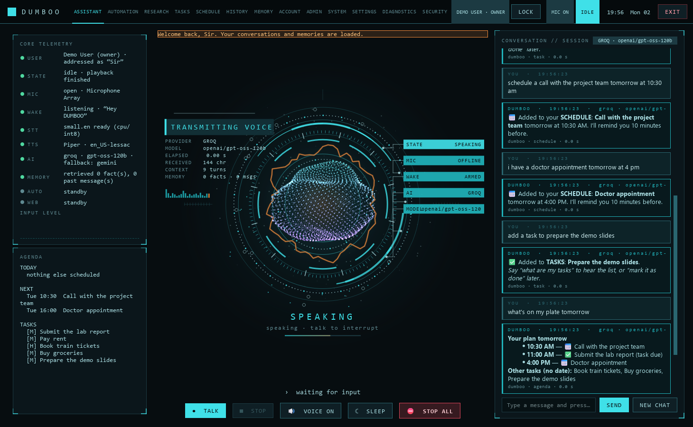
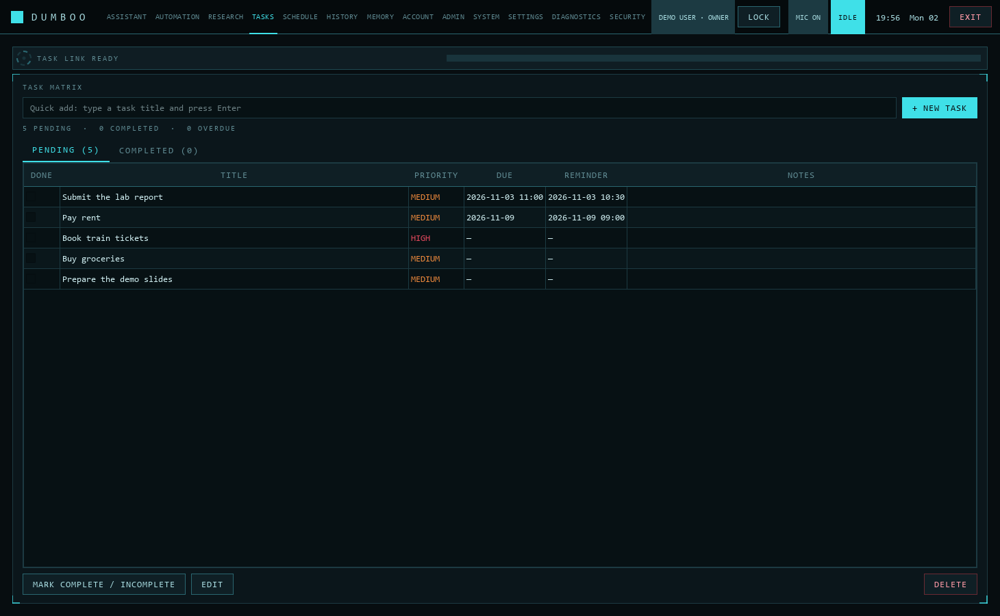
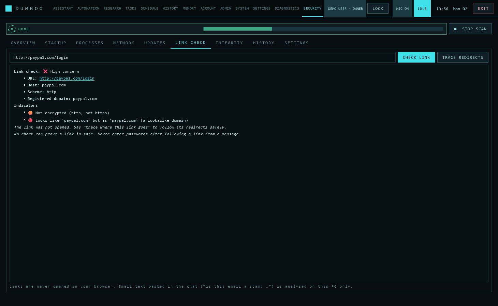
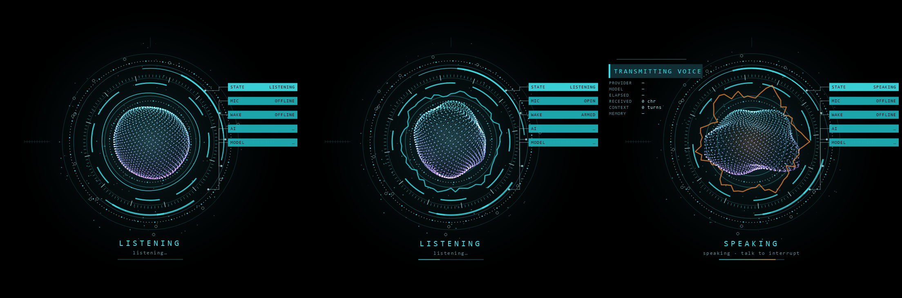
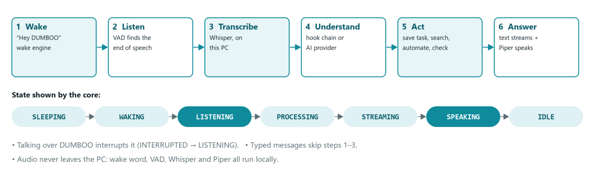
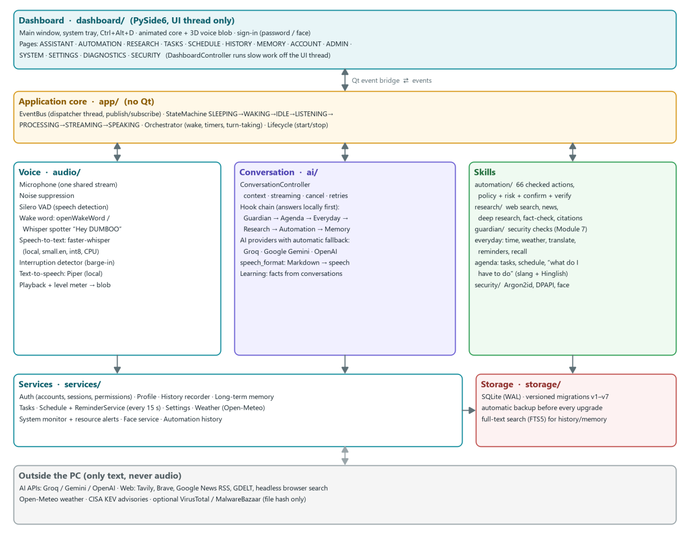

<div align="center">

# DUMBOO

### Your personal AI desktop assistant — talk to it, and it gets things done.

<p>


</p>

**Say “Hey DUMBOO”** — it listens, understands, answers out loud and acts: tasks, reminders, schedule, web research,
news, laptop automation and security checks, in a sci-fi dashboard with a 3D voice blob that reacts as you talk.



[Features](#-features) · [How it works](#-how-it-works) · [Tech stack](#-tech-stack) · [Quick start](#-quick-start) ·
[Try saying](#-try-saying) · [Documentation](#-documentation) · [Full guide](#full-guide)

</div>

---

## ✨ Features

| | Feature | What it does |
|---|---|---|
| 🎙️ | **Hands-free voice** | Always-on “Hey DUMBOO” wake word, speech detection, local Whisper speech recognition (Indian, British and American accents), natural Piper voice. Talk over it to interrupt. |
| 🧠 | **Natural conversation** | Groq, Google Gemini or OpenAI with **automatic switching** between providers and keys when one fails; short answers first, details on request. |
| ✅ | **Tasks, schedule & reminders** | “Add a task to submit the report by Friday 5 pm”, “schedule a call tomorrow at 3”, “what’s on my plate today?” — saved in the right place and spoken when due. Understands slang and Hinglish. |
| 🌐 | **Web research & news** | Live search with numbered citations, latest news with dates, deep research reports and fact-checking — every citation is checked against what was actually retrieved. |
| 💻 | **Laptop automation** | Open apps, manage files, type, read the screen, check performance, run project tests — 66 named actions with risk levels, confirmations and verified results. |
| 🛡️ | **Security guardian** | Defender/firewall/update overview, startup-entry investigation (signature, SHA-256, publisher), suspicious-link checks, file integrity monitoring — read-only by default. |
| 🔐 | **Accounts & privacy** | Owner and users, Argon2id passwords, **face unlock** with a liveness check, private history and long-term memory per user. Audio never leaves the PC. |
| 🫧 | **Living interface** | Animated core that shows every state, and a 3D point-cloud blob that reacts to your voice and to DUMBOO’s own speech. |

<table>
<tr>
<td width="50%"><p align="center"><sub><b>Tasks</b> — added by voice, with due times and reminders</sub></p></td>
<td width="50%"><p align="center"><sub><b>Security</b> — a lookalike phishing link flagged as high concern</sub></p></td>
</tr>
<tr>
<td colspan="2"><p align="center"><sub><b>Voice blob</b> — calm, reacting to your voice, and reacting to DUMBOO's voice</sub></p></td>
</tr>
</table>

## ⚙️ How it works



1. **Wake & listen** — a small local model waits for “Hey DUMBOO”; Silero VAD finds where your sentence ends.
2. **Transcribe** — Whisper turns speech into text on your laptop.
3. **Understand** — the text passes a chain of specialists:
   **Security → Tasks/Schedule → Everyday → Research → Automation → Memory → AI**.
   The first one that recognises the request handles it locally (fast and free); everything else goes to the AI.
4. **Act & answer** — the result streams onto the screen and is spoken; an **event bus** and a **state machine**
   keep every part in sync.

<details>
<summary><b>Architecture diagram</b></summary>
<br>


More in [docs/ARCHITECTURE.md](docs/ARCHITECTURE.md) and the illustrated [project guide (PDF)](docs/DUMBOO_Guide.pdf).
</details>

## 🧰 Tech stack

| Area | Technology |
|---|---|
| Language | Python 3.11 |
| Interface | PySide6 (Qt 6), custom-painted animations, NumPy 3D blob |
| Voice | sounddevice (PortAudio) · Silero VAD (onnxruntime) · openWakeWord / Whisper spotter · faster-whisper · Piper TTS |
| AI | Groq · Google Gemini (google-genai) · OpenAI — with automatic fallback |
| Research | httpx · trafilatura · Tavily, Brave, Google News RSS, GDELT · Playwright |
| Automation | uiautomation (Windows UI Automation) · mss · psutil · pypdf |
| Security | argon2-cffi · Windows DPAPI · OpenCV (YuNet + SFace) face unlock · PowerShell/registry checks |
| Storage | SQLite (WAL, FTS5) with versioned migrations and automatic backups |
| Testing | pytest — 778 tests with fakes for microphone, speaker, camera, AI, web and system |

## 🚀 Quick start

> Requires **Windows 10/11** and **Python 3.11**. Voice features need a microphone and speakers.

```powershell
git clone https://github.com/Hate-Is-Love/Dumbooo.git
cd Dumbooo
py -3.11 -m venv .venv
.\.venv\Scripts\Activate.ps1
python -m pip install -r requirements.txt
python scripts/download_models.py      # local voice models, one time (~600 MB)
copy .env.example .env                 # then add a free Groq or Gemini API key
python main.py --show
```

On first start DUMBOO asks you to create the owner account. Run `python main.py --diagnose` to check the
microphone, models and keys, and `python -m pytest` to run the test suite. Full setup:
[Install](#2-install-windows) · [Run](#3-run) · [AI keys](#142-set-up-gemini-default-free-tier).

## 🗣️ Try saying

| | |
|---|---|
| **Tasks & reminders** | “Add a task to submit the report by Friday at 5 pm” · “Remind me in 10 minutes to stretch” · “What’s on my plate today?” |
| **Schedule** | “Schedule a meeting with Rahul tomorrow at 3” · “Am I free at 4?” · “Move the meeting to 5 pm” |
| **Questions** | “Explain classification vs regression” · “Elaborate it for 10 marks” · “Translate good morning to Hindi” |
| **Web & news** | “Latest news about AI” · “Research the best laptops for students” · “Fact check: Python is faster than C” |
| **Laptop** | “Open Chrome” · “Take a screenshot” · “Why is my laptop slow?” · “Find PDFs in my Downloads” |
| **Security** | “Check my computer’s security” · “Show my startup programs” · “Is this link safe: …” |
| **Slang** | “Yo ping me tmrw at 5 to hit the gym” · “Knocked out the report” · “Aaj kya karna hai” |

## 📚 Documentation

- **[Project guide (PDF)](docs/DUMBOO_Guide.pdf)** — what DUMBOO is, features, architecture, stack and key code, explained.
- **[Architecture](docs/ARCHITECTURE.md)** — layers, threads, data flow and every module.
- **[Test report](docs/TEST_REPORT.md)** — what is tested automatically, what was verified live, and what wasn't.
- **[Wake word training](docs/WAKE_WORD_TRAINING.md)** — train a custom “Hey DUMBOO” model.
- **[Contributing](CONTRIBUTING.md)** · **[Security policy](SECURITY.md)**

## 🔒 Privacy

Wake word, speech detection, speech recognition and the voice all run **on your laptop** — no audio is sent
anywhere. Only the text of a message (and recent context) goes to the AI provider you choose. API keys stay in
your local `.env`; passwords are Argon2id hashes; face data and “remember me” tokens are encrypted with Windows
DPAPI. Risky actions always ask first. Details: [Privacy and safety](#10-privacy-and-safety).

## 📄 License

[MIT](LICENSE) © 2026 Roshan Mahesh Bhise ([@Hate-Is-Love](https://github.com/Hate-Is-Love))

---

<a id="full-guide"></a>

# Full guide

DUMBOO sits quietly in your system tray, listening only for **“Hey DUMBOO”**. When it hears the phrase, the
dashboard appears, records your command, transcribes it locally and answers out loud. If you talk over it, it
stops speaking. The sections below cover installation, every feature, settings, troubleshooting and limits.

**Contents**

1. [Requirements](#1-requirements)
2. [Install (Windows)](#2-install-windows)
3. [Run](#3-run)
4. [Exit safely](#4-exit-safely)
5. [Choose microphone and speaker](#5-choose-microphone-and-speaker)
6. [Run the automated tests](#6-run-the-automated-tests)
7. [Settings explained](#7-settings-explained)
8. [Manual hardware checks (do these once on your laptop)](#8-manual-hardware-checks-do-these-once-on-your-laptop)
9. [Troubleshooting](#9-troubleshooting)
10. [Privacy and safety](#10-privacy-and-safety)
11. [How the noise and interruption handling works, and its limits](#11-how-the-noise-and-interruption-handling-works-and-its-limits)
12. [Project layout](#12-project-layout)
13. [Linux / macOS notes](#13-linux--macos-notes)
14. [AI conversation (Module 2)](#14-ai-conversation-module-2)
15. [Accounts, history and long-term memory (Module 3)](#15-accounts-history-and-long-term-memory-module-3)
16. [Laptop automation (Module 4)](#16-laptop-automation-module-4)
17. [Web search, research and live news (Module 5)](#17-web-search-research-and-live-news-module-5)
18. [Everyday voice features, learning and the 3D voice blob](#18-everyday-voice-features-learning-and-the-3d-voice-blob)
19. [Face unlock and the welcome greeting](#19-face-unlock-and-the-welcome-greeting)
20. [Security & privacy guardian (Module 7)](#20-security--privacy-guardian-module-7)
21. [Tasks, schedule and reminders by voice and text](#21-tasks-schedule-and-reminders-by-voice-and-text)


## 1. Requirements

| | |
|---|---|
| Python | **3.11.x** (tested with 3.11.9) |
| OS | Windows 10/11 (primary). Linux/macOS: see notes at the end |
| Hardware | microphone + speakers/headphones (optional: text-only mode works without) |
| Disk | ~1.5 GB (Python packages ~1 GB, models ~210 MB) |
| Internet | only for installation and the one-time model download |

## 2. Install (Windows)

Open **PowerShell** in the `DUMBOO` folder (Shift + right-click the folder →
“Open in Terminal”), then run these commands one at a time.

**Step 1 – create a virtual environment** (a private Python just for DUMBOO):

```powershell
py -3.11 -m venv .venv
```

**Step 2 – activate it** (do this every time you open a new terminal):

```powershell
.\.venv\Scripts\Activate.ps1
```

Your prompt now starts with `(.venv)`. If PowerShell says *“running scripts is
disabled”*, run this once and then activate again:

```powershell
Set-ExecutionPolicy -Scope CurrentUser RemoteSigned
```

(In the old `cmd.exe` use `.venv\Scripts\activate.bat` instead.)

**Step 3 – install the packages:**

```powershell
python -m pip install --upgrade pip
python -m pip install -r requirements.txt
```

**Step 4 – download the voice models** (~210 MB, one time):

```powershell
python scripts/download_models.py
```

This downloads:

| Model | Used for | Size | Saved to |
|---|---|---|---|
| Piper `en_US-lessac-medium` | DUMBOO’s voice (TTS) | 63 MB | `models/piper/` |
| Whisper `small.en` | understanding your commands (STT), in Indian, British and American accents | 465 MB | `models/whisper/` |
| Whisper `base.en` | spotting “Hey DUMBOO” quickly, until you train a custom model | 145 MB | `models/whisper/` |
| openWakeWord feature models | only for a custom wake-word model | 2 MB | inside the openwakeword package |

The **Silero VAD** model is bundled inside `faster-whisper`, so there’s nothing to download.
If you skip this step, the Whisper models download automatically the first
time they’re needed. **Voice output stays off until the Piper voice exists.**

**Step 5 – check everything:**

```powershell
python main.py --diagnose
```

## 3. Run

```powershell
python main.py            # standby: dashboard hidden, listening for "Hey DUMBOO"
python main.py --show     # open the dashboard immediately
python main.py --text-only  # no microphone at all; type to DUMBOO
```

After starting in standby, a tray notification confirms DUMBOO is listening.
Look for the round cyan icon near the clock; you may have to click **^** to see
hidden icons.

**Waking DUMBOO**

- Say **“Hey DUMBOO”** (pause briefly, then say your command), or say it in
  one breath: “Hey DUMBOO, what’s on my list?”
- Press **Ctrl + Alt + D** anywhere in Windows.
- Click the tray icon (or right-click → *Show dashboard*).
- Run `python main.py` again. The second copy just wakes the first one.
  DUMBOO never runs two microphone listeners.

**Talking to DUMBOO**

- **TALK** button: start listening without the wake phrase.
- **Type** in the conversation box and press Enter. This works even without a microphone.
- **STOP SPEAKING**: cut DUMBOO off. Simply talking over it does the same.
- **SLEEP** (or the window’s ✕): hide the dashboard. DUMBOO keeps listening for
  the wake phrase. With *auto sleep* on, it also sleeps after 60 s idle.

## 4. Exit safely

Click **⏻ EXIT** (top right) and confirm, or right-click the tray icon →
**Exit DUMBOO**, or press **Ctrl + C** in the terminal. DUMBOO stops the
microphone, speaker, model workers and database cleanly. Closing the window
with ✕ does **not** exit; it only puts DUMBOO to sleep.

## 5. Choose microphone and speaker

1. List devices: `python main.py --list-devices`
2. In the dashboard open **SETTINGS → Audio devices**, pick the microphone and
   speaker, then click **SAVE SETTINGS**. The microphone reopens immediately.
   *System default* follows Windows’ default device.
3. Check the **ASSISTANT** page: the **MIC** row should read `open · <your mic>`
   and the input-level bars should move when you speak.

**Tip:** use headphones for the most reliable interruptions and no echo.

## 6. Run the automated tests

```powershell
python -m pytest
```

The tests use fake microphones, speakers and models, so they need no hardware.
Tests that use the real Silero VAD model and the real Piper voice run automatically
when those models are installed. The other hardware checks are manual (section 8).

## 7. Settings explained

All settings are validated before saving and stored in `data/settings.json`.
Defaults live in `config/settings.json`.

| Setting | Meaning |
|---|---|
| Noise suppression / strength | removes steady noise (fan, AC, hum) before VAD and STT |
| Wake word engine | `auto` = custom model if present, else Whisper phrase spotter |
| Wake sensitivity | higher = wakes more easily, but more false wakes |
| VAD speech threshold | how confident Silero must be that it hears speech (0.5 default) |
| End-of-speech silence | pause length that ends your command (900 ms). Raise it if you get cut off |
| Pre-roll | audio kept from *before* speech was detected, so your first word isn’t lost |
| Maximum recording | hard limit per command (15 s) |
| Give up listening after | return to idle if you say nothing (8 s) |
| Interruption | confidence, minimum talk time, and how much louder than DUMBOO’s echo you must be |
| Whisper model / language | `small.en` (default) makes about 2.5× fewer mistakes than `base.en` across Indian, British and American accents (measured: 2.2% vs 5.6% of words, Indian English in noise 3.7% vs 9.8%), but takes about 3 s instead of 1 s per command on a busy laptop. Pick `base.en` if speed matters more. Use a non-`.en` model for other languages |
| Piper voice | any Piper `.onnx` voice (with its `.onnx.json` next to it) |
| On startup | `sleep` (hidden, default) or `visible` |
| Auto sleep / sleep after | return to standby when idle |
| Animation intensity | lower = fewer particles, less CPU/GPU |
| Text-only mode | never open the microphone (restart required) |

## 8. Manual hardware checks (do these once on your laptop)

These checks need your real microphone, speakers and ears. Automated tests can’t do them.

A quick microphone, VAD and wake-phrase check without starting the dashboard
(nothing is saved):

```powershell
python scripts/mic_check.py --transcribe
```

Say “Hey DUMBOO”, pause, then say a sentence. Each utterance should be listed,
transcribed, and marked `wake phrase: YES` only for the wake phrase.

To test the **real wake engine** with your voice (DUMBOO itself should be closed, so
the two don't share the microphone):

```powershell
python scripts/mic_check.py --wake --seconds 60
```

Say “Hey DUMBOO” about 10 times, with a 2–3 second pause between tries. Try it also
with a command straight after the name (“Hey DUMBOO, what time is it?”). Each catch is
printed as `WAKE #n`, and the total is printed at the end.

| # | Check | Expected |
|---|---|---|
| 1 | Microphone capture: open the dashboard and speak | input bars move; orange bars while speaking |
| 2 | Wake word: sleep the dashboard, then say “Hey DUMBOO” from ~1 m | dashboard appears within ~1–2 s, core plays the wake animation, state LISTENING |
| 3 | False wakes: talk normally / play a video for 5 min | dashboard should not wake (tune sensitivity if it does) |
| 4 | Command: “Hey DUMBOO … add milk to my list” | transcript appears; test-mode reply is spoken; core pulses with the voice |
| 5 | Noise suppression: turn on a fan; repeat 4 with suppression on/off | commands still recognised; fewer false starts with suppression on |
| 6 | Interrupting: type a long message, then talk over the reply | DUMBOO stops within ~0.3–0.5 s and listens to you |
| 7 | Feedback: let DUMBOO speak on loudspeakers without talking | it must **not** interrupt itself or wake itself |
| 8 | Sleep/wake: wait 60 s idle | dashboard hides; tray says “sleeping”; “Hey DUMBOO” still works |
| 9 | Unplug a USB microphone while listening | ERROR state, “Microphone disconnected”; plug back in → recovers within ~3 s |
| 10 | Reminders: create an event 2 min ahead with a 1-min reminder | banner + Windows notification at the right minute |

## 9. Troubleshooting

**“No microphone” / MIC OFF / wake word NOT listening**
- Windows Settings → Privacy & security → **Microphone** → allow
  *Microphone access* **and** *Let desktop apps access your microphone*.
- Check the mic in Windows Sound settings (the level bar should move).
- `python main.py --list-devices`, then pick the device in SETTINGS.
- Close apps that take exclusive control of the mic (some call/recording apps).

**No voice / TTS “not found”**
- Run `python scripts/download_models.py`. The voice files must be
  `models/piper/en_US-lessac-medium.onnx` **and** `.onnx.json`.
- Check the speaker selection in SETTINGS, and the Windows volume mixer.

**Model download errors**
- The downloads come from huggingface.co and github.com. Check that a
  proxy or firewall isn’t blocking them, then re-run the script; it resumes cleanly.
- `python main.py --diagnose` shows which model files are missing.
- The warning *“To support symlinks on Windows, you either need to activate
  Developer Mode…”* is harmless. The model is copied instead of linked.

**“Hey DUMBOO” not detected / detected too often**
- You can say the command straight after the name (“Hey DUMBOO, open Notepad”),
  or pause and wait for the dashboard. Whisper often hears “Hey Dumbo”, which is
  accepted.
- How it decides: each burst of speech is transcribed by Whisper. If the name isn't
  heard clearly (noise can turn it into “dumpling”), Whisper is asked again with the
  name as a hint, and that answer only counts if Whisper is reasonably sure of the
  name. The log (`logs/dumboo.log`) shows `Wake phrase near miss` lines for phrases
  that almost matched. Many near misses mean you should raise the sensitivity.
- Check it with your own voice: `python scripts/mic_check.py --wake --seconds 60`
  (see section 8).
- Raise or lower **Wake sensitivity** in SETTINGS.
- A check takes about 1.5–3 s on a busy laptop. If memory is nearly full (DUMBOO
  warns you), close some programs: Whisper slows down a lot then.
- For a robust, low-CPU wake word, train a custom model: see
  [docs/WAKE_WORD_TRAINING.md](docs/WAKE_WORD_TRAINING.md).
- DUMBOO can’t hear you while the **laptop is asleep**. Windows suspends
  all apps then. Set *Settings → System → Power* so the PC doesn’t sleep while
  you want to use the wake word. Turning only the *screen* off is fine.

**DUMBOO interrupts itself / cuts me off**
- Use headphones, or lower the speaker volume.
- Raise *Interruption → Louder than echo by* (e.g. 9–10 dB) or *Must talk for*.
- If your sentences get cut off, raise *End-of-speech silence*.

**Everything is slow**
- First use loads models (a few seconds). Use `tiny.en` for STT on older
  laptops, and lower *Animation intensity*.

Logs are in `logs/dumboo.log` (no audio or background transcripts are ever
logged). The DIAGNOSTICS page has a live event log and a copyable report.

## 10. Privacy and safety

- Wake-word detection, VAD, speech recognition and speech synthesis all run
  locally. **No audio leaves your computer.**
- Microphone audio lives only in short in-memory buffers. Nothing is recorded to disk.
- The tray tooltip and the MIC indicator always show whether the microphone is
  in use. Right-click the tray → **Mute microphone** pauses all listening.
- Recognised speech is never executed as a command or shell instruction.

## 11. How the noise and interruption handling works, and its limits

- **Noise suppression**: spectral Wiener filtering with adaptive noise
  tracking (`audio/noise_suppression.py`). It removes *steady* noise well.
  It can’t remove other voices, TV dialogue or music with vocals.
- **VAD**: the Silero neural VAD separates speech from noise much better than a
  volume threshold. A door slam is loud but isn’t speech.
- **Self-echo**: while DUMBOO speaks, the wake word is disarmed and the speech
  recorder is paused. The interruption detector compares the microphone
  level with what the speaker is playing (playback-aware gating). It only
  interrupts when you are clearly louder than DUMBOO’s echo, for at least
  300 ms, and Silero agrees it is speech. This isn’t full acoustic echo
  cancellation: with loud laptop speakers next to the mic you may need to speak up.
  Headphones avoid the problem completely.

## 12. Project layout

```text
DUMBOO/
├── main.py                 entry point (--show, --text-only, --list-devices, --diagnose)
├── config/settings.json    default settings (user changes go to data/settings.json)
├── .env                    your API keys (create from .env.example; git-ignored)
├── config/system_prompt.txt  DUMBOO's personality / answer-style instructions (editable)
├── ai/                     Module 2/3: conversation controller, memory assistant, memory commands, prompts
│   └── providers/          Gemini, OpenAI and offline echo adapters
├── app/                    lifecycle, event bus, state machine, orchestrator
├── audio/                  microphone, noise suppression, VAD, wake word, STT, TTS, playback, interruption
├── automation/             Module 4: laptop automation (policy, controller, actions, platform)
├── research/               Module 5: web search, news, research, fact-checking, citations
│   └── providers/          Tavily, Brave, Google News RSS, GDELT, headless-browser search
├── dashboard/              PySide6 window, animated core, panels, tray, global hotkey
├── services/               accounts (auth), profile, history, memory, recorder, tasks, schedule, settings
├── security/               Argon2id passwords, secret filter, DPAPI token store
├── storage/                SQLite with versioned migrations
├── utils/                  paths, logging, diagnostics
├── scripts/                download_models.py, mic_check.py, ai_check.py (live AI check)
├── docs/                   ARCHITECTURE.md (diagrams), WAKE_WORD_TRAINING.md, TEST_REPORT.md
├── tests/                  automated tests (no hardware needed)
├── data/  logs/  models/   created at runtime, git-ignored (data/ = database, backups, your settings)
```

See [docs/ARCHITECTURE.md](docs/ARCHITECTURE.md) for architecture, thread and
data-flow diagrams, and where future modules plug in.

## 13. Linux / macOS notes

The code is cross-platform, but only Windows was tested.
- Linux: `sudo apt install libportaudio2` (for sounddevice), then
  `python3.11 -m venv .venv && source .venv/bin/activate`. The global
  Ctrl+Alt+D shortcut is Windows-only; use the tray icon.
- macOS: `source .venv/bin/activate`. Grant microphone permission to your
  terminal app in System Settings → Privacy & Security → Microphone.

## 14. AI conversation (Module 2)

DUMBOO now answers with a real AI model. Typed and spoken messages go through
the **same conversation**: speak one message, type the next, and follow-up
questions ("what are its advantages?") still work.

### 14.1 What happens when you ask something

```text
 you speak ──► wake word ─► VAD ─► Whisper (local) ──┐
                                                     ├─► ConversationController ─► Gemini / OpenAI
 you type  ──────────────────────────────────────────┘        (recent context)        (streaming)
                                                                     │
         chat panel ◄── text appears piece by piece ◄────────────────┤
         Piper voice ◄── whole sentences, Markdown removed ◄─────────┘
 core:  PROCESSING ─► STREAMING (first text) ─► SPEAKING (audio really playing) ─► IDLE
```

* **Short answers first.** "What is 15 × 8?" gets "120." Ask "explain", "in
  detail", "step by step" or "give an example" for more. Edit the style in
  `config/system_prompt.txt`, or switch off *Short answers first* in SETTINGS → AI.
* **Context:** the last 8 completed question/answer pairs (and at most 12,000
  characters) are sent with each message. Older turns are dropped first; a
  cancelled or failed answer is never stored. **CLEAR** in the chat forgets
  everything. Long-term memory comes in Module 3.
* **One answer at a time — the newest message wins.** Sending a new message (or
  talking over DUMBOO) cancels the answer in progress; its text and speech
  stop and are discarded. Pressing Send twice, or the same text arriving twice
  within 3 seconds, is ignored.
* **STOP** cancels both the generation and the speech. **🔊 VOICE ON/OFF**
  switches spoken answers off while text conversation keeps working.
* Errors appear in the chat with a **↻ RETRY** button. DUMBOO retries by itself
  only for short, temporary problems (network, timeout, a per-minute limit; at
  most 2 times, never after text has appeared). It **never retries an invalid
  key or an exhausted quota, and never switches to another provider on its own**.

### 14.2 Set up Gemini (default, free tier)

1. Go to <https://aistudio.google.com/apikey>, sign in with a Google account and
   click **Create API key**. No credit card is needed for the free tier.
2. Give the key to DUMBOO in **one** of these ways:
   * In the dashboard: **SETTINGS → AI CONVERSATION → Google Gemini key**, paste,
     **SAVE KEY**. The key is written to the local `.env` file and never shown again.
   * Or copy `.env.example` to `.env` and set `GEMINI_API_KEY=` there.
3. Check it works without using generation quota:

   ```powershell
   python scripts/ai_check.py --health-only
   ```

   Then, optionally, a real 3-question test that uses a little quota:

   ```powershell
   python scripts/ai_check.py
   ```

**Free-tier facts you should know** (from Google's docs, October 2026; they change, so check yours):

* Google no longer publishes one fixed table. Your project's real limits are at
  <https://aistudio.google.com/rate-limit>. Daily quotas reset at **midnight Pacific time**.
* Per-model daily limits can be small for the newest Flash models.
  **Flash-Lite** models (for example `gemini-3.5-flash-lite`) usually allow many
  more free requests and answer faster. Pick one in SETTINGS → AI if you hit the limit often.
* New projects get the 3.x models; the 2.5 family is limited to earlier users.
* On the free tier, Google may use prompts to improve its products (see Google's
  terms). Enable billing on the project if that matters to you.

### 14.3 Switch to paid Gemini or to OpenAI

**Paid Gemini:** enable billing for the same Google Cloud project in AI Studio.
In DUMBOO nothing changes except, optionally, the model name
(SETTINGS → AI → *Gemini model*, e.g. `gemini-3.8-flash`). The same key keeps working.

**OpenAI:**

1. Create a key at <https://platform.openai.com/api-keys> and add credit under
   *Billing*. **A ChatGPT Plus/Pro subscription does NOT include API credit;
   API usage is billed separately.**
2. SETTINGS → AI → *OpenAI key* → **SAVE KEY** (or `OPENAI_API_KEY=` in `.env`).
3. SETTINGS → AI → *Provider* → **OpenAI**, check *OpenAI model* (default
   `gpt-5-mini`; any model your account can use may be typed in) → **SAVE SETTINGS**.
4. **TEST CONNECTION**, or run `python scripts/ai_check.py --provider openai`.

**Changing models:** type any model ID into *Gemini model* / *OpenAI model*.
No code changes. If a model rejects an optional setting (temperature, thinking
level, reasoning effort), DUMBOO drops that setting for that model automatically.

**Environment variables** (optional; they override the dashboard for that run,
and are never saved): `AI_PROVIDER`, `GROQ_MODEL`, `GEMINI_MODEL`, `OPENAI_MODEL`,
`AI_REQUEST_TIMEOUT`, `AI_MAX_OUTPUT_TOKENS`, `AI_TEMPERATURE`, `AI_STREAMING_ENABLED`.
See `.env.example`.

### 14.3a Several providers and keys, with automatic switching

DUMBOO can hold keys for **Groq, Gemini and OpenAI at the same time**, and several keys
per provider. It answers with the first one and **switches automatically** when one has a
problem, so the conversation keeps going.

**Default order:** Groq first, because it is the fastest. Measured on this laptop, the first
words arrive in 0.3–0.6 s, and the first answer of a session is just as quick, because DUMBOO
connects in the background at start-up. Then Gemini, then OpenAI.

**Add keys:** SETTINGS → AI CONVERSATION. Each provider has its own row:
* **SAVE KEY** replaces the main key.
* **ADD KEY** keeps the existing keys and adds an extra one (`GROQ_API_KEY_2` … `_9` in
  `.env`).

The status under each row shows how many keys are saved (masked). Keys stay in `.env` on
this PC and are never shown, logged or sent anywhere except to that provider.

**When it switches** (before any text appears):

| Problem | What DUMBOO does | That key/provider rests for |
|---|---|---|
| Daily or monthly quota used up | next key / provider | 30 min |
| Rate limit ("too many requests") | next key / provider | the provider's own wait time |
| Key rejected, model not available | next key / provider | 1 hour (or until you save a new key) |
| Network trouble, provider down, no answer in *Switch after* seconds (12 s) | next key / provider | 15–30 s |
| A request the model can't take (e.g. a screenshot for Groq's text models) | next provider for this request | no rest |

The chat line shows it briefly, for example: *"Groq quota used up, answering with
Gemini…"*. The provider label then shows who actually answered.

**It never switches:**
* to get around a provider's safety block;
* after an answer has started to appear. That would restart it, so the problem is reported
  instead, and **RETRY** uses the next provider.

**Settings:**
* *Provider* chooses which provider goes first.
* *Switch automatically* turns switching on or off. When it's off, only the chosen provider's
  main key is used.
* *Backup order* sets the order of the others (default `groq,gemini,openai`).
* *Switch after* sets how long to wait before trying the next one.

**Groq models:**
* `openai/gpt-oss-120b`: the default. Best quality, and still very fast.
* `openai/gpt-oss-20b`: even faster.
* `qwen/qwen3.8-27b`.

*Groq reasoning* `low` keeps answers quick; the models' hidden reasoning is never shown or
spoken. Groq's free plan has per-minute and per-day limits (see
<https://console.groq.com/settings/limits>). When you hit them, DUMBOO switches as described
above.

### 14.4 AI settings (SETTINGS → AI CONVERSATION)

| Setting | Default | Meaning |
|---|---|---|
| Provider | Groq | the provider that answers first: `Groq`, `Gemini`, `OpenAI`, or `Echo` (offline test mode, repeats you; no AI) |
| Groq / Gemini / OpenAI model | `openai/gpt-oss-120b` / `gemini-3.6-flash` / `gpt-5-mini` | any model ID your key can use |
| Groq reasoning | `low` | quick answers from Groq's reasoning models |
| Switch automatically | on | use the other providers/keys when one has a problem (14.3a) |
| Backup order / Switch after | `groq,gemini,openai` / 12 s | order of the backups; how long to wait before switching |
| Gemini thinking | `low` | lower = faster, cheaper; empty = model default |
| OpenAI reasoning | `low` | for reasoning models; empty = not sent |
| Max output tokens | 1024 | upper limit, not a target. Short answers come from the instructions; if an answer is cut, the chat says so |
| Temperature | model default | leave on default unless you know you need it |
| Stream answers | on | show text while it arrives (and start speaking sooner) |
| Short answers first | on | concise style; still answers in detail when you ask |
| Request timeout | 30 s | give up waiting after this |
| Remember last | 8 turns | short-term context window |

### 14.5 How to test it

* **Text:** open the dashboard (`python main.py --show`), type `What is RAM?` and
  press Enter. You should see your message, an *analysing…* bubble, the answer
  appearing word by word, and the core switching to the exploded "ANALYSING DATA"
  view, then *RECEIVING DATA*, then *SPEAKING* when the voice starts.
  Then type `What are its advantages?`. The answer should be about RAM.
* **Voice:** say "Hey DUMBOO", wait for the listening animation, ask a question.
  The transcript appears in the chat, then the answer, spoken aloud.
  Follow up by typing, then by voice: same conversation.
* **Streaming:** ask `Explain how a CPU works in detail`. Text should arrive in
  pieces, and speech should start after the first sentence, before the text is finished.
* **Interrupt:** while DUMBOO is speaking a long answer, say something. It stops and listens.
* **Text-only:** click **🔊 VOICE ON** to turn speaking off, or run
  `python main.py --text-only` to use no microphone at all.

### 14.6 Troubleshooting AI errors

| Message | What it means | What to do |
|---|---|---|
| *Gemini/OpenAI API key is missing* | no key configured | section 14.2 / 14.3 |
| *rejected the API key* | key wrong, deleted or for another project | create a new key, SAVE KEY, TEST CONNECTION |
| *quota … is used up (daily limit)* | free daily requests used | wait for the reset (midnight Pacific), choose a Flash-Lite model, enable billing, or deliberately select another provider |
| *rate limit reached* | too many requests per minute | wait a few seconds; DUMBOO already retried briefly |
| *OpenAI API account has no remaining credit* | no API billing | add credit at platform.openai.com (ChatGPT Plus does not count) |
| *model … not available to this account* | wrong or retired model name | pick one from the drop-down or check the provider's model list |
| *took too long / Could not reach* | network or provider slow | check the internet; raise *Request timeout* |
| *used its whole output budget* | the model spent its tokens thinking | lower thinking/reasoning, or raise *Max output tokens* |

`python main.py --diagnose` shows the provider, model and whether a key is set
(never the key itself). Keys are masked in every log line.

### 14.7 Privacy

* Only the **recognised text** of your message, the recent conversation and the
  style instructions are sent to the provider you selected. **Never audio**,
  never your tasks/schedule database, never files.
* OpenAI requests are sent with `store=false`. Gemini's free tier may use
  prompts for product improvement (Google's terms).
* API keys live only in `.env` / environment variables (git-ignored), are never
  shown in the dashboard after saving, and are redacted from logs.

### 14.8 Known limitations (Module 2)

* Gemini was verified live with a free-tier key (see `docs/TEST_REPORT.md`).
  OpenAI was tested only with the real SDK against a local imitation server.
  Run `python scripts/ai_check.py --provider openai` once you have a key.
* Free-tier answers can take 1–12 s, and models sometimes return "high demand"
  (503) errors at busy times. The default is `gemini-3.6-flash` because the
  newest `gemini-3.8-flash` was often overloaded during testing. DUMBOO retries
  briefly; if it keeps happening, pick another model (for example a Flash-Lite
  model) in SETTINGS → AI.
* Free-tier limits and model names change; the defaults reflect Google's and
  OpenAI's documentation as of October 2026.
* Cancelling a Gemini stream stops DUMBOO immediately, but the SDK can only
  close the network stream at its next piece of data. OpenAI streams close instantly.
* Conversation context is in memory only (lost on restart): Module 3.
* The animated core is CPU-rendered: about 30–45% of one core while thinking
  or speaking at the default intensity; it stops completely while the dashboard
  is hidden. Lower *Animation intensity* if your laptop runs warm.

## 15. Accounts, history and long-term memory (Module 3)

DUMBOO now knows **who** it is talking to. Every person has their own account,
their own conversation history and their own memories, and nobody can see
anyone else's. Everything is stored locally in SQLite (`data/dumboo.db`).

### 15.1 First start: create the owner account

1. Install the new dependency once (inside the activated `.venv`):

   ```powershell
   python -m pip install -r requirements.txt
   ```

2. Start DUMBOO with `python main.py --show`. Because no owner exists yet, the
   **OWNER SETUP** screen appears (amber identity scanner).
3. Enter a username (e.g. `roshan`), your display name, how DUMBOO should address you
   (**Sir** by default), and a password (8+ characters, not easy to guess). Click **INITIALISE OWNER**.
4. The scanner verifies, turns green (**ACCESS GRANTED**) and the dashboard opens.

There is **no default account and no default password**. The owner can only be
created on this screen, and only while no owner exists. Registering the
username "owner" or "admin" gives no special rights. Exactly one owner can exist; the
database itself enforces this.

**Your existing data:** the first start after updating upgrades the database from
v1 to v2 automatically. It first writes a full backup to
`data/backups/dumboo-<date>-before-v1-to-v2.db`, and your existing tasks and
events are given to the owner account when you create it. Nothing is deleted.

### 15.2 Signing in, locking and staying signed in

* **Sign in** with username and password. Wrong username *or* password gives the
  same message ("Invalid username or password"), so nobody can find out which accounts exist.
* After **5 failed attempts** that username is locked for **15 minutes**.
* **LOCK** (top bar) or **ACCOUNT → SIGN OUT** signs you out immediately. The chat on
  screen is cleared, and DUMBOO forgets the current conversation context and stops speaking.
* Inactivity: you are signed out after **30 minutes** without activity.
* **Stay signed in on this PC** (optional, off by default) keeps you signed in after
  restarts for up to 7 days. The session token is encrypted with Windows DPAPI
  (only your Windows account can read it); the database stores only a hash of it.
  Don't use it on a shared Windows account.
* Restarting DUMBOO never signs anyone in by itself (except a valid "stay signed in" session).
* Not signed in? Voice and text still reach DUMBOO, but it only answers
  "Please sign in on the dashboard first". Nothing is saved and nothing is sent to the AI.

All of these numbers can be changed by the owner on **ADMIN → Account security & privacy**.

### 15.3 Creating users (owner)

**ADMIN → + CREATE USER**: enter a username and display name. Leave the password
empty to get a **temporary password** (shown once, with a Copy button). Give it to
the person privately. At their first sign-in DUMBOO makes them choose their own password.

Other owner tools on the ADMIN page:

| Button | What it does | Asks for your password again? |
|---|---|---|
| EDIT NAME | change a user's display name | no |
| PERMISSIONS | turn features on/off per user (AI chat, memory, export, tasks, system pages, system settings) | no |
| RESET PASSWORD | new temporary password, signs the user out everywhere | **yes** |
| DISABLE / REACTIVATE | block or allow sign-in (signs them out at once) | **yes** |
| MAKE OWNER | transfer ownership (you become a normal user) | **yes** |
| DELETE ACCOUNT | delete the account **and all of its data** | **yes** |
| AUDIT LOG | who changed which account and when | no |
| SAVE SECURITY SETTINGS | registration, timeouts, lockout, retention, memory rules | **yes** |
| BACKUP NOW / INTEGRITY CHECK | database backup and health check | no |

**Privacy between users:** the owner manages *accounts*, not private *content*.
No screen or function lets the owner open another user's conversations or memories.

Self-registration ("Create an account" on the sign-in screen) is **off** by default.
If the owner turns it on, new accounts are always normal users.

Normal users manage their own profile on **ACCOUNT**: display name, how DUMBOO
addresses them, short or detailed answers, spoken answers on/off, password change,
export of their own data, and sign-out.

### 15.4 Conversation history

* Every typed and spoken exchange is saved automatically under the signed-in
  user: your message as soon as it is accepted, then DUMBOO's real answer.
  Failed answers are saved as `failed` (with the reason), and stopped or interrupted
  ones as `interrupted` (with any partial text). Nothing is ever made up to fill a gap.
* **HISTORY** page: list, open, search (full-text), **CONTINUE** (brings a past
  conversation back into the chat, with its context), **RENAME**, **ARCHIVE**,
  **DELETE**, **EXPORT MY DATA** (a JSON file of your conversations, memories,
  preferences, tasks and events) and **CLEAR ALL HISTORY**.
* **NEW CHAT** in the chat panel starts a new conversation; the old one stays in HISTORY.
* **Deleting conversations does not delete memories.** Facts DUMBOO learned stay
  on the MEMORY page until you delete them there.
* Optional retention: the owner can make DUMBOO delete conversations older than N days.

### 15.5 Long-term memory

DUMBOO remembers useful facts about **you** across restarts and uses them when answering.

| Say or type | What happens |
|---|---|
| "Remember that my project is called DUMBOO." | saved: *project = DUMBOO* (confirmed by you) |
| "Actually, my project is called Nova." / "Update my saved information: …" | the old fact is replaced (kept as history, never shown as current) |
| "What do you remember about me?" / "Show my saved memories" | lists your facts |
| "Forget my favourite colour" / "Forget that" / "Delete this memory" | erases that fact |
| "Clear my memories" | asks "Are you sure?" first; say "yes" or "no" |
| "Call me Captain" | changes how DUMBOO addresses you |
| "What is my project called?" | DUMBOO looks it up and answers: "Sir, your project is called DUMBOO." |

These commands are handled by DUMBOO itself, with fixed rules. The AI never decides
what is stored or deleted.

Automatic memory: clear, stable statements such as "my name is …", "I live in …",
"I work as …", "I'm working on …" or "my favourite … is …" are saved with lower
confidence ("you mentioned it"). Questions, guesses ("maybe…") and casual chat are not saved.
The owner can switch this off.

**Never stored:** passwords, PINs, API keys, tokens and similar secrets. DUMBOO
refuses them. **Sensitive** information (health, finances, religion, politics …) is
only saved after you say "yes" to a confirmation question.

The **MEMORY** page shows every fact with its category, source (confirmed by you /
you mentioned it), confidence and when it was saved and last used. It also has
**ADD**, **EDIT**, **DELETE**, **CLEAR ALL MEMORIES** and a **CHANGE LOG**. Forgetting really
erases the text: only a content-free log entry remains.

### 15.6 How DUMBOO uses your data when answering

For each message (voice or text), DUMBOO:

1. checks that a valid session exists and identifies you from it (the dashboard
   cannot choose or change whose data is used);
2. searches **your own** saved facts and earlier messages (SQLite full-text search,
   ranked by relevance and recency). The core shows violet data particles and
   **RETRIEVING MEMORY** while this happens;
3. sends the AI only a small, relevant selection (by default up to 6 facts and 4
   earlier messages), clearly marked as data, plus the instruction to say "I don't
   have that saved" instead of guessing. Secrets are filtered out;
4. saves the exchange and any new clear facts.

### 15.7 How private data is kept separate

* The user is always taken from the validated session token, never from the dashboard,
  the AI, or what someone says.
* Every database query for private data includes the signed-in user's id. Asking for
  someone else's record id simply finds nothing.
* A database trigger additionally refuses to attach a message to another user's conversation.
* Switching accounts or signing out clears the chat on screen, the AI's short-term context,
  pending confirmations and per-session caches.
* Session events never carry the token into the dashboard widgets; logs never contain
  passwords, hashes, tokens or keys.

### 15.8 Security limits (please read)

* **The database is not encrypted.** SQLite files are plain files. Account
  separation is enforced by DUMBOO, but **anyone who can log in to your Windows
  account, or who copies `data/dumboo.db`, can read it with other tools**. For
  stronger protection use Windows BitLocker or device encryption, a Windows account
  password, and don't share your Windows account.
* "Stay signed in" is as safe as your Windows account (DPAPI).
* The owner of the computer can always delete or replace the program and its files.
  Application-level controls protect users *from each other inside DUMBOO*, not from
  the computer's administrator.

### 15.9 Backup and restore

* **Automatic:** a full copy is written to `data/backups/` before every database upgrade.
* **Manual:** ADMIN → **BACKUP NOW** (safe while DUMBOO runs).
* **Restore:** exit DUMBOO, rename `data/dumboo.db` (keep it), then copy the chosen file from
  `data/backups/` to `data/dumboo.db`. Delete `data/dumboo.db-wal` and `data/dumboo.db-shm` if
  present, then start DUMBOO.
* If an upgrade ever fails, DUMBOO stops with a message and changes nothing (the upgrade
  runs in one transaction). Restore the backup as above and report the log file.
* Before trying anything risky, copy the whole `data` folder somewhere safe.

### 15.10 Tests for this module

```powershell
python -m pytest
```

The tests use temporary databases and fake AI providers, so no API key or internet is needed.
Module 3 files: `test_auth.py` (34), `test_isolation.py` (7), `test_history_memory.py` (31),
`test_db_migrations.py` (9), `test_dashboard_accounts.py` (10). The results are in
`docs/TEST_REPORT.md`.

### 15.11 Known limitations (Module 3)

* Memory recognition is rule-based (English phrasing such as "my X is Y",
  "I live in …"). Unusual phrasing is stored as a whole sentence, or not recognised as a
  command; use the MEMORY page to fix entries.
* Retrieval uses keyword full-text search, not meaning-based (embedding) search. A
  question must share words with the saved fact (e.g. "project").
* Only one person can be signed in to the dashboard at a time. Voice commands always
  belong to whoever is signed in; DUMBOO does not recognise people by voice.
* Reminders are delivered only to the signed-in user. Another user's reminders wait until
  they sign in (and are skipped if the event started more than 15 minutes ago).
* Locked-out usernames stay locked for the configured time even after a restart. The owner
  can't unlock early (wait, or lower the lockout time).

## 16. Laptop automation (Module 4)

DUMBOO can now **do things on your laptop**, not just talk: open and arrange apps, find and
organise files, type, read the screen, check performance, use the web, run your project's tests,
and remember how you like to work. You use it exactly like the chat: type a command, or say
"Hey DUMBOO, …". Ordinary questions still go to the AI as before.

### 16.1 Setup (once)

Inside the activated `.venv`:

```powershell
python -m pip install -r requirements.txt
```

This adds four packages: `uiautomation` (reads and clicks on-screen controls through Windows'
accessibility API), `mss` (screenshots, only when needed and allowed), `playwright` (drives
DUMBOO's own browser window) and `pypdf` (reads PDFs). No browser download is needed:
DUMBOO's browser uses the Microsoft Edge that is already installed.

Then start DUMBOO as usual (`python main.py --show`). The first start upgrades the database to
v3 (automation task history) and writes a backup to `data/backups/` first.

**Which folders may DUMBOO touch?** By default it may read and change files in your Desktop,
Documents, Downloads, Pictures, Music and Videos (OneDrive-redirected folders are found
automatically) and only *read* its own project folder. Your other folders are invisible to it.
To allow another folder (for example `C:\final_deskbot_dumbo`): **AUTOMATION → APPS & FOLDERS →
+ ADD FOLDER…** (owner only; DUMBOO asks for your password), or say *"allow access to
C:\final_deskbot_dumbo"*. DUMBOO's own data, Windows, Program Files, ProgramData and AppData are
always protected, and files that hold credentials (`.env`, `*.key`, `*.pem` …) are never read.

**Which programs may DUMBOO open?** Only approved ones: Chrome, Edge, Firefox, VS Code,
Antigravity IDE, Notepad, File Explorer, Calculator, Paint, Word, Excel and PowerPoint (those not
installed show "NOT FOUND"). Add more on **AUTOMATION → APPS & FOLDERS → + APPROVE PROGRAM…** or
say *"approve Spotify as an application"*. Command shells and script hosts (cmd, PowerShell,
Python, wscript, regedit …) can never be approved.

### 16.2 What you can say

| Feature | Examples |
|---|---|
| 1. Apps | "open Chrome" · "minimize Chrome and switch to Notepad" · "close Notepad" · "is Spotify running?" · "open my usual coding application" |
| 2. Files | "find my latest Python project" · "create a folder named AI Projects" · "find my DUMBOO README" · "find PDFs in my Downloads" → "move these PDFs into my college folder" · "organize my Downloads folder" · "rename report.docx to final" · "delete old.txt" · "find duplicate files" · "undo the last file operation" |
| 3. Keyboard & mouse | "open Notepad and type: Hello world" · "save the current document" · "copy the selected text" · "press ctrl+s" · "scroll down" · "click the Save button" |
| 4. Screen | "what's on my screen?" · "explain the error on my screen" · "find the Save button" · "take a screenshot" |
| 5. System | "check my laptop performance" · "how much RAM is available?" · "why is my laptop slow?" · "which applications are consuming the most memory?" · "check my disk space" |
| 6. Web | "open YouTube" · "search for official Python documentation" → "open the first result" · "summarise this page" · "download https://…/file.pdf into my documents folder" · "open github.com in dumboo's browser" · "list browser tabs" |
| 7. Multi-step goals | "prepare my demo project for development" · "open my project and run its tests" · anything else in plain words, e.g. "back up my college folder into a new Backup folder" (the AI proposes a plan; you approve it) |
| 8. Memory | "remember that my DUMBOO project is in this folder" · "remember my usual coding application is VS Code" · "remember that the project website is https://…" · "remember this workflow as morning setup" → "run my morning setup workflow" · "continue the task from yesterday" |
| 9. Documents & code | "summarise report.pdf" · "create a Python file that calculates factorial" · "run the tests for my demo project" · "install the dependencies" · "explain this traceback: …" · "check the logs of my project" · "create a README based on my project files" |
| 10. Safety | "stop everything" / the ⛔ buttons · "show my automation history" |

When something is missing or ambiguous (which project? which editor? which file?), DUMBOO
**asks** instead of guessing.

### 16.3 How a request is handled

```
your words -> signed in? -> rules (common commands) -> AI planner (only for other goals)
           -> memory lookup (only when you say "my ...", "usual", "saved" ...) -> structured steps
           -> policy check + risk for EACH step -> "Shall I do it?" (medium/high risk)
           -> run with a time limit -> verify the result -> task history -> answer
```

* **Structured steps, never free text.** Every step is one of 66 named actions with checked
  arguments (`files.move`, `apps.open`, `dev.run` …). The AI may only *propose* steps from that
  list; it can never run a shell command. Project commands are fixed templates (run tests, install
  `requirements.txt` into the project's own `.venv`, git status …).
* **Risk levels.** Low (runs straight away): read information, open approved apps, search permitted
  folders, create new folders and files. Medium (asks first): move/rename/edit files, type into
  non-editor programs, click buttons, install dependencies, send a screenshot to the AI. High
  (always asks): delete (to the Recycle Bin), overwrite, force-close, end a process,
  submit/buy/send buttons, approve programs or folders. The AI can't lower a risk level by calling
  an action "safe": the risk is decided by DUMBOO's code from what the step actually does.
* **Answering.** Say "yes"/"no" (after a spoken question DUMBOO keeps listening, so no wake
  phrase is needed), or press **APPROVE / DENY** on the AUTOMATION page. Unanswered questions
  expire after 5 minutes. A new command cancels a waiting question.
* **Verification.** A step only counts as done when an independent check confirms it: the window
  exists and is in front, the file exists with the right size and content (Python files are also
  syntax-checked), the typed text is read back from the window, the command's real exit code and
  test summary, the page really loaded, the downloaded size matches. If a check isn't possible,
  the reply says **"not verified"**; DUMBOO never claims success it couldn't confirm.
* **Stopping.** "Stop everything", **⛔ STOP ALL** (ASSISTANT page) or **⛔ EMERGENCY STOP**
  (AUTOMATION page) cancel the running task, kill running commands and drop queued tasks. The
  reply lists what had already finished (which is *not* undone) and what was cancelled. The
  normal **■ STOP** button also stops automation. Signing out cancels your tasks.
* Tasks that take longer than about 8 seconds keep running; you get "⏳ Working on it" and the
  result is added to the chat (and spoken) when it finishes.

### 16.4 How memory is used

Automation knowledge is stored as normal memories of *your* account (so it appears on the
MEMORY page and on AUTOMATION → MEMORY, where you can edit or delete it):
`<name> project path`, `<name> folder`, `usual <purpose> application`, `<name> website`,
`workflow <name>`. DUMBOO only looks these up when your request refers to them, checks that a
saved folder still exists (and is permitted) before using it, and asks when nothing or more than
one thing matches. Another user can never see or use your memories or tasks. Passwords, keys and
URLs with embedded passwords are refused. Normal task results are **not** turned into memories;
only what you explicitly ask to remember.

### 16.5 Privacy and safety rules

* Text that looks like a password, PIN, key or token is never typed or pasted; password fields
  are never read (screen) or filled (web).
* Typing goes only into the window DUMBOO brought to the front, one character at a time, and stops
  immediately if another window comes forward. "Open Notepad and type …" always types into a
  **new blank document** (Windows 11 Notepad reopens your old tabs; DUMBOO never types into them).
* The screen is read through accessibility (local). A screenshot is only sent to your AI provider
  when that text isn't enough, and by default only after you say yes (AUTOMATION → SETTINGS →
  "Screenshots to the AI": ask / allow / never). Screenshots are never stored.
* Screen and web content is treated as untrusted data: instructions found on a page or in a
  dialog are never followed.
* DUMBOO's browser is a separate Edge window with its own profile (`data/browser_profile`); your
  normal browser's passwords and cookies are never touched. Downloads go to `Downloads\DUMBOO`
  (or a folder you name), are checked, and are **never opened**. Programs/scripts are not
  downloaded unless the owner allows it.
* Task history stores steps, results and errors, but never typed text, form values, file contents
  or screenshots. Use **AUTOMATION → HISTORY → DELETE / CLEAR HISTORY** to remove it.
* Edited or replaced files are backed up first to `data/automation_backups/`.

### 16.6 The AUTOMATION page

* **TASK**: command box (same as chat), the current task with each step's status and how it was
  verified, the confirmation card (risk, exact file list or diff, APPROVE / DENY), CANCEL TASK.
* **HISTORY**: every task with its steps, verification and exact changed files; SAVE AS
  WORKFLOW, DELETE, CLEAR HISTORY.
* **APPS & FOLDERS**: approved programs (installed or not) and permitted folders (owner edits).
* **MEMORY**: your automation memories, with a check whether each folder still exists.
* **SETTINGS**: resource alert thresholds (CPU, memory, disk, battery), screenshot policy,
  confirmation timeout (owner).

While a task runs, the core on the ASSISTANT page shows a ring with one segment per step
(green = verified, cyan = running, amber = waiting for you, red = failed) and an EXECUTING TASK
read-out. Resource alerts appear as banners (and tray notifications when the window is hidden).

### 16.7 Manual checks on your laptop

1. *"check my laptop performance"* → real CPU / RAM / disk / battery / network numbers.
2. *"open Notepad and type: Hello from DUMBOO"* → a new Notepad tab with exactly that text and
   "✓ verified: … read back … matches exactly". Close that tab without saving.
3. *"what's on my screen?"* with any program in front → its visible text and buttons.
4. *"search for official Python documentation"* → DUMBOO's Edge window opens with results;
   *"open the first result"* → python.org.
5. Permit `C:\final_deskbot_dumbo`, then *"remember that my DUMBOO project is in
   C:\final_deskbot_dumbo\DUMBOO"*, *"remember my usual coding application is VS Code"*,
   *"open DUMBOO"*.
6. Put a few test files into a new folder inside Downloads, *"organize <that folder>"* → preview →
   *"yes"* → *"undo the last file operation"* → *"yes"*.
7. *"delete <a test file>"* → HIGH risk question → *"no"* → nothing happens.
8. Start a slow task (e.g. *"run the tests for my project"*) and say *"stop everything"*.

### 16.8 Tests for this module

```powershell
python -m pytest tests -k automation
```

128 automated tests (fake desktop, fake browser, scripted AI: no real windows, no network, no API
costs). `docs/TEST_REPORT.md` lists them and the checks done on the real desktop.

### 16.9 Known limitations (Module 4)

* Windows only. Programs running **as administrator** can't be controlled by a normal DUMBOO
  (Windows blocks it).
* Common commands are recognised by rules; unusual wording goes to the AI planner (needs a working
  AI key and quota) and then needs your approval.
* Screen reading depends on the program supporting Windows UI Automation (most do; games and some
  custom apps don't, and then a screenshot is offered).
* Web automation works in DUMBOO's own browser window; it does not control tabs in your normal
  Chrome/Edge (it only opens pages there). Sites that block automated browsers, or need a login
  you haven't done in DUMBOO's window, won't work; DUMBOO never bypasses logins or CAPTCHAs.
* Typing is deliberately slow (about 60 characters per second) so editors don't drop keys.
* Emergency stop cancels between steps, kills running commands and interrupts typing; an action
  already handed to another program (a page load, a file copy) finishes or times out on its own.
  Completed steps are never reversed automatically (use "undo the last file operation" for
  moves/renames/edits).
* Workflows and "continue the task" can't replay steps that used private text (typed text, form
  values), because that text is never stored; DUMBOO tells you which steps were left out.
* Scanned PDFs (images only) can't be read without OCR; DUMBOO says so.

## 17. Web search, research and live news (Module 5)

DUMBOO can now **look things up on the internet** and tell you where every fact came from:
quick web answers, the latest news with real publication dates, longer research reports that
compare sources, and fact-checks of claims. Use it like everything else: type it, or say
"Hey DUMBOO, …". Ordinary chat ("tell me a joke", "explain recursion") is **not** searched; it
goes to the AI as before.

### 17.1 Setup

**Nothing extra is needed.** With no key, DUMBOO uses free, keyless sources:

| What | Source without a key | Notes |
|---|---|---|
| News | Google News RSS feed + the GDELT news index | free; GDELT allows about one request every 5 seconds |
| Web search | DUMBOO's own hidden Edge window (Playwright) reading Bing results | uses the Edge already on your laptop; slower (about 10 s) |
| Reading pages | DUMBOO downloads the page and extracts the main text (trafilatura); PDFs with pypdf | respects `robots.txt`; never logs in or bypasses paywalls |

Install the new packages (once, in the DUMBOO folder with the venv active):

```powershell
pip install -r requirements.txt
```

**Optional, for faster and more reliable web search:** get a free **Tavily** key at
<https://app.tavily.com> (free plan with monthly search credits, no card needed), then add this
line to your `.env` file and restart DUMBOO:

```text
TAVILY_API_KEY=tvly-...your key...
```

(Brave Search is also supported with `BRAVE_API_KEY`.) Keys are only read from `.env`. They are
never logged, saved in the database, put in a web address or sent to the AI. DUMBOO **never
switches to a paid service by itself**. If you pick a provider on the RESEARCH → SETTINGS tab and
its key is missing, it tells you so instead of quietly using something else.

The AI summary uses your normal Module 2 AI (Gemini by default). If the AI is unavailable (no
key, or the daily quota is used up), you still get the sources and short extracts from them,
clearly marked "no AI summary".

### 17.2 What you can say

| You say | What happens |
|---|---|
| "search the web for the Python 3.13 release notes" | a quick answer with numbered citations [1] [2] |
| "what is the latest version of pandas?" | answered from live sources. Time-sensitive questions are researched automatically; you can turn this off on the SETTINGS tab. |
| "latest news about AI chips" · "today's tech news" · "news about ISRO this week" | the main developments, each with publisher, publication date, why it matters, and links |
| "research the best laptops for machine learning under 1 lakh and compare sources" | a report: executive summary, findings, source comparison, uncertainty and unanswered points |
| "fact check: Python 3.11 is 10 times faster than 3.10" · "is it true that …" · "verify that answer" | a verdict per claim (supported / contradicted / partly supported / not enough evidence / outdated) with the evidence |
| "open the official documentation for pandas" | finds the official site and opens it in your browser, through the Module 4 safety checks |
| "show the sources" · "open the second source" · "tell me more about the first development" | works on the last answer, with no new search |
| "remember these findings for my project" · "use the sources I saved earlier" | saves or uses research findings in your memory |
| "show my previous research about laptops" · "open the research I saved" · "refresh my last research" · "compare this with the previous research" · "continue the research we did yesterday" | research history |
| "export this report" | saves it as a Markdown file in a permitted folder, through Module 4 with its usual checks |
| "stop" | cancels the running research |

**Voice:** say it after "Hey DUMBOO". DUMBOO speaks a short summary (no web addresses, no
citation numbers) and shows the full answer with links on screen.

### 17.3 How an answer is built and checked

1. **Decide** whether the message needs the web at all. This uses rules, with no AI call.
2. **Plan** the searches. For research, the AI writes a small JSON plan; a rule-based plan is
   used if the AI is unavailable. Limits are 6 searches, 8 pages and 150 seconds (SETTINGS tab).
3. **Search**, remove duplicates, rank by source quality (official/primary, established news,
   reference, community, low) and group copies of the same story.
4. **Read** the best pages:
   * only public http(s) pages;
   * never local or private network addresses, checked again after every redirect;
   * with size and time limits, and `robots.txt` respected.

   Pages that refuse access (paywall, login, 403) are **not** bypassed; they are marked
   "snippet only".
5. **Write** the answer with the AI, from the retrieved text only. Page text is treated as
   untrusted data: instructions inside a web page are ignored and can never start an action.
6. **Check the citations** (`citation_service.py`):
   * citation numbers that don't match a retrieved source are removed;
   * web addresses that weren't retrieved are removed;
   * statements without a source are dropped;
   * a date is only kept if it appears in the source text.

**Dates:** a publication date is only shown when the page declares it (in its metadata) or it is
in the page address. Otherwise the answer says "date unknown". Dates from a search engine are
labelled as such. News older than the requested period is never shown as new. The AI never
supplies dates.

**Independent sources:** in fact-checks, pages from the same organisation (for example python.org
and docs.python.org) or copies of the same agency story count as **one** origin.

### 17.4 Memory and history

* Every research run is saved in your **research history**, per user like conversations: the
  question, answer, sources (title, address, date, short extract) and timings. Other users can't
  see it. You'll find it on the HISTORY tab of the RESEARCH page, or by saying "show my previous
  research".
* Findings are only saved to long-term memory when you say so ("remember these findings …").
  They appear as `research: <topic>` memories and can be deleted like any memory.
* For personal questions ("which of these laptops suits my course?") DUMBOO uses relevant saved
  memories and says which ones it used. Unrelated questions don't touch your memory.
* Your conversation export (Module 3) now includes your research history.

### 17.5 The RESEARCH page

The page has four tabs:
* **RESEARCH:** ask a question, follow live progress through the real stages, cancel, and read
  the answer with clickable sources.
* **HISTORY:** search, reopen, refresh or delete earlier research.
* **SAVED FINDINGS:** your research memories.
* **SETTINGS:** providers, keyless fallback, automatic research, region, language and limits.

The animated core shows "RESEARCHING" while it works, and a WEB line shows the current provider.

### 17.6 Manual checks on your laptop

1. Ask "latest news about artificial intelligence". Dates and publishers are shown, and the links
   open.
2. Ask "search the web for the official Python documentation". docs.python.org is cited.
3. Say "Hey DUMBOO, what's the latest news about cricket?", then "stop" while it searches.
4. Ask "fact check: the Eiffel Tower is in Berlin". The verdict should be "contradicted".
5. Ask "export this report".

   **Note:** on this laptop, Windows *Controlled Folder Access* is on. It blocks programs from
   writing to Documents and Desktop. DUMBOO then explains this, and nothing is written. To allow
   it: Windows Security → Virus & threat protection → Ransomware protection → Allow an app
   through Controlled folder access → add `.venv\Scripts\python.exe`.

### 17.7 Tests for this module

```powershell
python -m pytest tests -k research
```

The 61 automated tests use fake search providers, fake web pages (httpx MockTransport) and a
scripted AI: no network, no API keys, no costs. `docs/TEST_REPORT.md` lists them and the live
checks.

### 17.8 Known limitations and costs (Module 5)

* **Costs:** keyless sources are free. Tavily and Brave have free plans; DUMBOO never upgrades or
  pays. The AI summary uses your Gemini free quota. A research report is 1–3 AI calls; when the
  daily quota is used up, you get the extractive answer instead.
* Keyless web search drives Bing in a hidden browser. It is slower than an API, and it can stop
  working if Bing changes its page or shows a bot check (DUMBOO never solves CAPTCHAs). A Tavily
  key avoids this.
* Typical times without a key: a web answer takes about 10 s, a fact-check about 30 s, and news
  40–80 s. News is slower because Google News links must be resolved to the original article one
  by one.
* Many news sites block automated readers (403, `robots.txt`) or are paywalled. Those sources are
  shown as "snippet only" and count for less.
* GDELT is rate-limited and sometimes slow. When that happens, DUMBOO continues with Google News
  alone and says so.
* Dates: pages that don't declare a publication date show "date unknown". This is on purpose:
  guessed dates were found to be wrong.
* Answers are only as good as the sources found. Always check important facts through the links.

## 18. Everyday voice features, learning and the 3D voice blob

Everything below works **by voice** ("Hey DUMBOO, …") **and typed**, through the same path.

### 18.1 Reminders

| Say | What happens |
|---|---|
| "remind me to call mom at 5" | saved for 5 PM today. Without am/pm, 1–6 means PM; otherwise it's the next time that hasn't passed |
| "remind me in 10 minutes to drink water" · "after half an hour …" | relative times |
| "remind me tomorrow at 9 am about the exam" · "on Friday at 3:30 pm …" · "on 25 October at 10 …" · "next Monday …" · "tonight …" · "tomorrow morning …" | days and parts of the day |
| "remind me to buy milk" | DUMBOO asks when, and you just answer ("in 20 minutes") |
| "what are my reminders" · "do I have any reminders tomorrow" | lists them |
| "cancel the reminder about mom" · "cancel that reminder" · "cancel all my reminders" (asks first) | removes them |
| "snooze" · "remind me again in 15 minutes" | after a reminder went off |

**Storage and delivery:**
* Reminders are saved in the database. They appear on the SCHEDULE page and survive restarts.
* When one is due, DUMBOO **says it out loud**, shows a banner and the chat line, and sends a Windows
  notification.
* If DUMBOO was closed or you weren't signed in at the time, you still get it within 12 hours,
  marked as *missed*.
* Unusual phrasings ("next Thursday after lunch") are worked out by the AI and checked: the time
  must be in the future and within a year.

### 18.2 Time, date and weather

| Say | Answer |
|---|---|
| "what time is it" · "what's the date" | from the laptop's clock (no internet, no AI) |
| "what time is it in London" | the city's local time |
| "what's the weather" · "temperature in Delhi" · "weather tomorrow" · "will it rain today" · "do I need an umbrella" · "how hot is it outside" | current conditions plus today's or tomorrow's forecast |

* Weather comes from **Open-Meteo**: free, no key, and only the city name is sent.
* Without a city, DUMBOO uses your home city ("remember that I live in Pune"), or asks.

### 18.3 Translation

"translate good morning to Hindi", "how do you say thank you in Marathi", "what is good night in
Spanish", "translate to French: where is the station", "translate that to Hindi" (DUMBOO's last
answer).

* **Main languages:** English, Hindi, Marathi and Spanish. Others work too (French, German, Gujarati,
  Tamil, Telugu, Bengali, Urdu, Japanese, …).
* **Output:** the translation in its own script, plus a pronunciation line. DUMBOO's voice is English,
  so it **speaks the pronunciation** ("In Hindi: Suprabhaat, aap kaise hain?").
* **Direction:** Hindi or Marathi text is translated into English automatically.
* **Speed:** measured live with Groq, a translation takes about 0.5 s.

### 18.4 Conversation memory and learning

* **Every conversation is saved** in the local database, permanently by default. The owner can set a
  limit under ADMIN → *Delete conversations older than*.
* **"What did we talk about yesterday / today / last week / on Monday?"** gives a short summary from
  the saved history.
* **DUMBOO learns about you as you talk.** When you mention something lasting ("I'm preparing for
  GATE 2027", "I hate spicy food", "my sister Priya is a doctor"), the AI saves it as a learned fact
  and uses it in later conversations.
  * Learned facts are marked *inferred* on the MEMORY page, where you can correct them ("remember …")
    or delete them ("forget …").
  * Health, religion, politics, money, passwords and ID numbers are **never** learned.
  * Messages that aren't about you are never sent for learning, and it makes at most one learning
    request every 20 s.
  * Switch: ADMIN → *Learn preferences and interests from conversations*.

### 18.5 Casual commands and slang

App and website commands understand everyday phrasing:
* "pull up yt", "fire up notepad", "hop on insta", "gimme spotify", "take me to gmail";
* "youtube kholo", "notepad band karo";
* a bare name: "youtube";
* "play lofi on youtube" (opens the search results);
* "whats my battery at", "hows my ram", "snap the screen";
* "kill notepad", "hide notepad".

Short names: yt, insta/ig, fb, x/twitter, gpt, wa, calc, vs code. Ordinary chat that happens to
use these verbs ("show me a joke", "go to sleep", "play a game with me") is **not** treated as a
command.

### 18.6 The 3D voice blob

The centre of the animated core is now a **3D cloud of glowing dots**:
* **Colours** follow the current phase: cyan when listening, violet when thinking, red on errors,
  dim when sleeping. Every ring, arc, wave and panel of each phase stays as before.
* **It reacts to voices:** it swells and folds with your voice while listening, and with DUMBOO's
  voice while speaking. It churns while thinking and gives a small pulse for each piece of an answer.
* **Interactive:**
  * click it to talk (same as TALK);
  * drag it to spin it;
  * hover to make it ripple;
  * right-click for *Sensitivity: Low / Normal / High / Very high* or to switch it off.
* **Settings:** SETTINGS → DASHBOARD → *Show the 3D voice blob* and *Blob sensitivity* (0 = calm,
  1 = normal, 3 = very lively).
* **Cost:** the dots are drawn with numpy into one image per frame. The whole core costs about
  17 ms per frame on this laptop, and nothing at all while the window is hidden.

## 19. Face unlock and the welcome greeting

### 19.1 Set up face unlock (once)
1. Sign in with your password and open **ACCOUNT**.
2. In the **Face unlock** panel, type your password (to confirm it's you) and press
   **SET UP FACE UNLOCK**. The camera turns on and the scanner shows you, mirrored.
3. Follow the prompts: look straight at the camera, then turn your head slightly to one side, then
   to the other. That's 8 samples in about 10 seconds. Good, even light on your face helps.

### 19.2 Sign in with your face
On the sign-in screen, press **◉ SIGN IN WITH FACE**:
1. Look at the camera. DUMBOO recognises you over a few frames.
2. Turn your head slightly to one side.
3. Look back at the camera.

ACCESS GRANTED follows, and DUMBOO greets you. **CANCEL FACE SCAN** turns the camera off at once.
Your password always works too.

### 19.3 How it works and what is stored
* **Local only:** the OpenCV face models YuNet (finds your face) and SFace (turns it into 128
  numbers) run on this PC. Nothing goes to the internet.
* **Stored:** only those numbers, never pictures. They are **encrypted with Windows DPAPI** for
  your Windows account, so a copied database can't use them. Remove them any time with
  **REMOVE FACE DATA**.
* **Camera:** on only during setup or face sign-in, with a red **CAMERA ON** mark. Frames are
  analysed in memory and dropped.
* **Matching:** a stricter similarity than OpenCV's reference value (0.42 instead of 0.363),
  over several frames, with one face in view.
* **Lockout:** after 5 failed face attempts within 15 minutes, face unlock pauses until someone
  signs in with a password.
* **Admin actions** (ADMIN page, settings) still ask for the password.
* **Owner switch:** ADMIN → *Allow signing in with face unlock*.

**Limit, honestly:** the head-turn check stops photos, but a *video* of you turning your head
could fool it. DUMBOO's face unlock is a convenience, not bank-grade security. This laptop's
infrared camera with Windows Hello is stronger. Don't use face unlock on a shared PC where
someone might try that.

### 19.4 The greeting
After every sign-in (face, password or a remembered session), DUMBOO greets you in the chat and
out loud:
* **The first time**, it introduces itself: who it is, how to talk to it, and what it can do.
* **Afterwards**, it's short: "Good evening, Sir. Welcome back. I'm DUMBOO, ready when you are.
  You have 2 reminders today." With face unlock, it starts with "Face recognised."

Turn it off on ACCOUNT → Preferences → *Greet me after sign-in*.

### 19.5 Setup on another PC
```powershell
pip install -r requirements.txt
python scripts/download_models.py
```
This installs `opencv-python-headless` (the variant without its own Qt, so it can't clash with
DUMBOO's PySide6) and downloads the two face models into `models/face/`.


---

## 20. Security & privacy guardian (Module 7)

DUMBOO can review this PC's security **when you ask**. Each check reads real local data
(Windows Defender, the firewall, the registry, Task Scheduler, file signatures and hashes) and
reports only what it observed. **It never changes anything on its own.** The only change it can
make is turning off a startup entry. That needs your spoken or clicked "yes", and it can be
undone.

### 20.1 What it does

| Feature | How it works | Needs admin? |
|---|---|---|
| Security overview | Defender (`Get-MpComputerStatus`), registered antivirus (Windows Security Center), firewall profiles, UAC, last installed Windows update, Defender detections (events 1116/1117), startup summary, app updates | No. BitLocker and Secure Boot do, so they show **UNKNOWN** |
| Startup entries | Run/RunOnce keys (HKCU and HKLM), Startup folders (shortcuts resolved), non-Microsoft scheduled tasks, automatic services outside `C:\Windows` | No |
| Investigate an entry or process | Path, command (secrets redacted), whether the file exists, size, dates, SHA-256, Authenticode signature and publisher, unusual-location checks, optional threat intelligence, assessment, confidence, limitations, recommendation | No |
| Processes | Top programs by memory or CPU, and details for one process. High use is reported as a fact, not as a sign of malware | No. Some system processes show "access denied" |
| Network | Interfaces, active connections with the program that owns each one, programs listening on all interfaces, unusual ports. No traffic is captured | No |
| Updates & advisories | `winget upgrade` (read-only, nothing installed, no agreements accepted) and the public CISA Known Exploited Vulnerabilities list, matched by app name and labelled "version not verified" | No |
| Link / message check | Offline checks: lookalike brands, IP-address hosts, `@` tricks, encoded characters, shorteners, risky top-level domains, plain http, urgent wording. Following redirects is opt-in and limited: public hosts only, no scripts, 64 KB, 6 hops | No |
| File integrity | A SHA-256 baseline of a folder **you choose**, then a comparison on request: modified, missing and new files | No |

**Statuses:**
* **PASS**, **WARNING**, **FAIL**.
* **UNKNOWN**: the setting couldn't be read, often because it needs administrator rights. This is not the same as "off".
* **NOT_SUPPORTED**: not available on this OS.

**Assessments:** **No obvious concern**, **Suspicious indicators**, **High concern** and
**Inconclusive**. DUMBOO says "known malicious" only when a threat-intelligence service reports
the file's hash as malicious. Every finding is labelled *observed*, *inference* or *external
intelligence*.

**Supported OS:** Windows 10 and 11, tested on Windows 11 build 26200 as a standard user. On
Linux and macOS the process, network, link and integrity features work, and the Windows-specific
checks report NOT_SUPPORTED. That path is covered by tests only, not run on a real Mac or Linux PC.

### 20.2 Using it

On the dashboard, use the **SECURITY** page. The owner can see it by default. It has the tabs
OVERVIEW, STARTUP, PROCESSES, NETWORK, UPDATES, LINK CHECK, INTEGRITY, HISTORY and SETTINGS.
Only one scan runs at a time; **STOP SCAN** or saying "stop the scan" cancels it.

Example voice or text commands (the wording is flexible):

* "Check my computer's security" or "run a security check"
* "Show my startup programs"
* "Investigate the startup entry OneDrive"
* "Check the signature of OneDrive"
* "Inspect the process chrome"
* "Show my network connections"
* "Check for security updates"
* "Is this link safe https://example.com/login" or "trace where this link goes"
* "Is this message a scam: …"
* "Monitor my project folder" or "check the integrity of my project folder"
* "Show the latest security findings"
* "Disable the startup entry …": DUMBOO explains what will happen, then waits for "yes" or "no"
* "Restore the startup entry …"
* "Save this report" (saved to `data/security_reports/`) or "Explain this report"

Anything else is passed on unchanged to the other modules, so existing commands keep working.

*Example report (shortened; the values are only an illustration):*

```
Investigation: ExampleUpdater
- Mechanism: Registry Run key · Applies to: this user
- Executable: C:\Users\<you>\AppData\Local\Example\updater.exe · File exists: yes
- SHA-256: 3f1c… · Signature: NotSigned · Publisher: UNKNOWN
- Threat intelligence: NOT_CHECKED (external lookups are off)
Findings
- Not digitally signed (observed)
- Runs from a per-user AppData folder (observed)
Assessment: Suspicious indicators · Confidence: Medium
Recommended action: look up the publisher; if you don't recognise it, disable the entry (reversible).
```

### 20.3 Threat intelligence and privacy

Threat-intelligence lookups are off by default. To use them, turn on **external lookups** and
pick a provider in SECURITY → SETTINGS. Then **only the file's SHA-256 hash** is sent: never the
file, its path or your name.

* VirusTotal: add `VIRUSTOTAL_API_KEY=` to `.env`.
* MalwareBazaar: add `MALWAREBAZAAR_API_KEY=` to `.env`.

Keys are read from `.env` only and are never logged or shown. Without a key, the report says
`NOT_CHECKED` and gives the reason. The CISA advisory list is downloaded without sending
anything about you. To switch it off, set `advisory_feeds: false`.

### 20.4 Permissions, remediation and recovery

* `security.view`: run checks and read reports. The owner has it by default, and it can be granted to others on the ADMIN page.
* `security.manage`: owner only. Needed to disable or restore startup entries.

| Level | What | Confirmation |
|---|---|---|
| 0 | Read-only checks and reports | None |
| 1 | Save a report, or start monitoring a folder you chose | None (nothing on the system changes) |
| 2 | Disable or restore a **per-user** startup entry (an HKCU Run value or a Startup-folder item) | A "yes" (spoken, typed or in a dialog) |
| 3 | Ending processes, deleting files, changing the firewall or Defender | **Not done by this module.** Ending a process stays in Automation, with its own confirmation |

Disabling and restoring work like this:
1. Before disabling, DUMBOO saves the original value or file in the `security_actions` table.
2. It then checks that the change took effect.
3. "Restore the startup entry …" (or the **RESTORE…** button) puts the entry back exactly as it was.
4. Every attempt is recorded, including refused and failed ones.

Machine-wide entries (HKLM, scheduled tasks, services) can't be disabled from DUMBOO. They are
reported as not supported, with step-by-step manual instructions.

### 20.5 Configuration

In `config/settings.json`, section `security` (also editable in SECURITY → SETTINGS):

```json
"security": {"monitor_enabled": true, "external_lookups": false, "threat_intel_provider": "none",
             "advisory_feeds": true, "scan_timeout_s": 120, "file_integrity_enabled": true}
```

Environment variables override these settings for one run:
* `SECURITY_MONITOR_ENABLED`
* `SECURITY_EXTERNAL_LOOKUPS_ENABLED`
* `SECURITY_THREAT_INTEL_PROVIDER` (`none`, `virustotal` or `malwarebazaar`)
* `SECURITY_SCAN_TIMEOUT_SECONDS`
* `SECURITY_FILE_INTEGRITY_ENABLED`

`SECURITY_AUTO_REMEDIATION` is accepted only as `false`: there is no automatic remediation.

File integrity refuses these folders: `C:\Windows`, Program Files, ProgramData, drive roots,
other users' folders and DUMBOO's own data folder. It handles up to 20,000 files per folder.
Files over 512 MB are skipped and listed.

### 20.6 Database and rollback

Migration **v6** adds six tables:
* `security_scans`
* `security_findings`
* `integrity_scopes`
* `integrity_baselines`
* `integrity_events`
* `security_actions`

Each row belongs to one user, so nobody sees another person's results. No existing table is
changed. As with every upgrade, a copy of the database is saved to `data/backups/` first. To roll
back, restore that copy as described in 15.9.

### 20.7 Tests

```powershell
python -m pytest tests/test_guardian.py -q
```

There are 46 tests. They use fake PowerShell, a fake registry, fake network clients and
temporary folders. They never read or change the real startup entries, firewall, Defender or
processes, and they never call a paid API.

### 20.8 Limitations

* BitLocker and Secure Boot need administrator rights, so they show UNKNOWN for a standard user.
* "Windows updates" shows the latest *installed* update; pending updates aren't listed.
* Advisories are matched by app name only. DUMBOO doesn't check whether your installed version is affected.
* Signatures are checked with `Get-AuthenticodeSignature`. A valid signature proves who signed
  the file, not that the file is harmless.
* Without threat intelligence, DUMBOO can't recognise known malware. It points out unusual
  things, but it isn't an antivirus.
* File integrity runs only when you ask; nothing watches folders in the background.
* Only per-user startup entries can be disabled from DUMBOO.


---

## 21. Tasks, schedule and reminders by voice and text

You can manage the TASKS and SCHEDULE pages by talking or typing, in normal English, slang or
Hinglish. Each reply says which page the item was saved on, and both pages update straight away.

### 21.1 Tasks (TASKS page)

| Say or type | What happens |
|---|---|
| "add a task to submit the report by Friday at 5 pm" | Saved with its due date and time; a reminder is set for 4:30 PM |
| "put milk on my list" / "jot down call the bank" / "new task: book tickets, urgent" | Added (urgent → high priority) |
| "what are my tasks" / "what's pending" / "anything overdue" / "my tasks for tomorrow" | Read out, with what's due when |
| "mark the report as done" / "knocked out the report" / "I'm done with laundry" | Ticked off |
| "move pay rent to Monday" / "make lab report urgent" | Due date (and its reminder) or priority changed |
| "delete the task buy milk" / "remove milk from my list" / "clear completed tasks" | Deleted (clearing all asks first) |
| "undo" | Reverses the last change made this way |

**When a task's reminder goes off:**
* A deadline with a time is announced 30 minutes before it.
* A deadline with only a day is announced at 9 AM that day.
* You can set the time yourself: "… and remind me at 8", or "remind me an hour before".

DUMBOO speaks the reminder and shows it on screen, for example: "Reminder: time to send the invoice. It's due at 5:00 PM, in 29 minutes." Then say "done" to tick it off, or "snooze for 15 minutes".

On the TASKS page you can also set a due time and a reminder: **+ NEW TASK** / **EDIT** → "At a time" and "Remind me".

### 21.2 Schedule (SCHEDULE page)

| Say or type | What happens |
|---|---|
| "schedule a meeting with Rahul tomorrow at 3, remind me 30 minutes before" | Event saved; you're reminded 30 minutes before (10 by default) |
| "I have a doctor appointment on Friday at 4" / "pencil in a dentist appt Monday 10 am" | Event saved |
| "schedule a dentist appointment" | DUMBOO asks "When is it?" |
| "what's on my schedule tomorrow" / "what meetings do I have this week" | Read out with times |
| "move the meeting with Rahul to 5 pm" / "push the call to Tuesday" | Only the time, or only the day, changes |
| "cancel the meeting with Rahul" / "scrap the dinner" | Cancelled ("undo" brings it back) |
| "am I free tomorrow at 3" / "when is my dentist appointment" | Checked against your schedule |

### 21.3 "What do I have to do?"

Ask "what do I have to do today", "what's on my plate tomorrow", "how's my day looking",
"what's next", "aaj kya karna hai" or "kal ka plan kya hai". DUMBOO lists your events, reminders
and timed task deadlines in time order. Then it adds tasks due that day, overdue tasks, and
tasks without a date.

### 21.4 Which page a reminder is saved on

* **A to-do with a deadline goes to TASKS**, with its own reminder. Example: "remind me to pay rent by Monday".
* **A plain timed reminder goes to SCHEDULE.** Example: "remind me to call mom at 5", "ping me in 20 mins to check the oven".
* **A reminder about a task you already have goes on that task**, instead of creating a duplicate. Example: "remind me to water the plants at 6".

If a reminder comes due while DUMBOO is talking, it waits and speaks the reminder as soon as it has
finished.

### 21.5 Slang, text-speak and Hinglish

| You say | DUMBOO understands |
|---|---|
| tmrw, 2day, 2nite, mins, hrs, appt, mtg, hw | tomorrow, today, tonight, minutes, hours, appointment, meeting, homework |
| ping me / buzz me / gimme a heads up / lemme know / don't let me forget | remind me |
| put X on my list / jot down X | add a task X |
| knocked out / crossed off / done with / X is done | mark X as done |
| scrap / ditch / nix / call off | cancel |
| bump / push / slide X to … | move X to … |
| kal, aaj, parso, subah, shaam, raat, 5 baje, yaad dila dena | tomorrow, today, day after tomorrow, morning, evening, night, at 5, remind me |

If a phrasing isn't covered by these rules but clearly mentions tasks, the schedule or reminders,
DUMBOO asks the AI to read it. The AI answers in a fixed format that is checked before anything is
saved. This happens only if no other part of DUMBOO understood the message. General questions,
such as "how do I schedule a meeting in Outlook" or "plan a trip to Goa", still go to the normal
AI chat.

### 21.6 Database

Migration **v7** adds three empty columns to `tasks`: `due_time`, `remind_at` and `reminded_at`.
Existing tasks are unchanged. As with every upgrade, a backup is written to `data/backups/` first
(see 15.9).

### 21.7 Tests

`tests/test_agenda.py` has 33 tests covering:
* slang being turned into plain commands;
* tasks, schedule and the agenda answer;
* reminders being saved on the right page;
* task reminders being delivered, then completed with "done" or snoozed;
* normal chat not being taken over;
* the AI reading unusual phrasings;
* keeping each user's tasks private;
* the task dialog.
