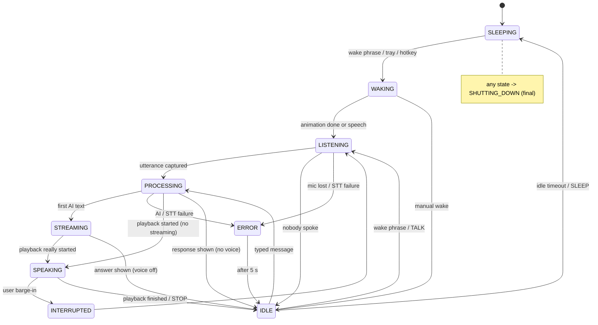
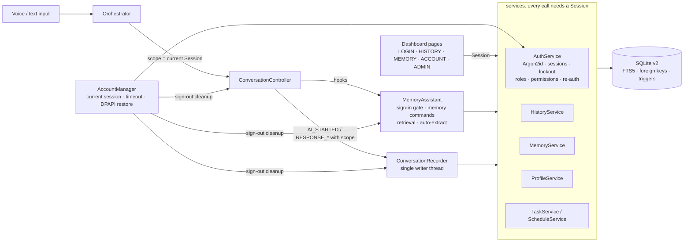
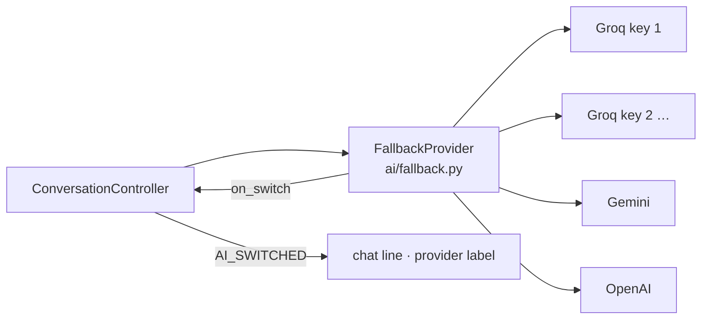

# DUMBOO architecture (Module 1 + Module 2)

## Layers

```mermaid
flowchart TB
    subgraph UI["dashboard/ (PySide6, UI thread only)"]
        MW[MainWindow + tray + Ctrl+Alt+D hotkey]
        CORE[CoreWidget animation]
        PANELS[Conversation / Tasks / Schedule / System / Settings / Diagnostics]
        CTRL[DashboardController + QtEventBridge]
    end
    subgraph APP["app/ (no Qt)"]
        BUS[(EventBus\ndispatcher thread)]
        SM[StateMachine]
        ORCH[Orchestrator]
        LIFE[Lifecycle]
    end
    subgraph AI["ai/ (Module 2, no Qt)"]
        CONV[ConversationController\ncontext · prompt · cancel · retries]
        PROV[AIProvider interface]
        GEM[GeminiProvider\ngoogle-genai]
        OAI[OpenAIProvider\nopenai Responses API]
        SPF[speech_format\nMarkdown -> speech, sentence chunker]
    end
    subgraph AUDIO["audio/"]
        MIC[Microphone\n1 shared stream]
        PIPE[AudioPipeline thread]
        NS[NoiseSuppressor]
        VAD[Silero VAD v6]
        SEG[SpeechSegmenter]
        WAKE[WakeWordService\nopenWakeWord or Whisper spotter]
        INT[InterruptionDetector]
        STT[SpeechToText\nfaster-whisper worker]
        TTS[TextToSpeech\nPiper worker]
        PLAY[AudioPlayer]
    end
    subgraph SVC["services/ + storage/"]
        SET[SettingsService]
        TASK[TaskService]
        SCHED[ScheduleService + ReminderService]
        MON[SystemMonitor]
        DB[(SQLite)]
    end
    CTRL <--> BUS
    MW --> CTRL
    ORCH <--> BUS
    ORCH --> SM
    SM --> BUS
    PIPE --> BUS
    STT --> BUS
    TTS --> BUS
    ORCH --> PIPE & WAKE & STT & TTS & CONV
    CONV --> PROV
    PROV --> GEM & OAI
    CONV --> BUS
    ORCH --> SPF
    TASK & SCHED --> DB
    PANELS -- QThreadPool --> TASK & SCHED & MON & SET
```



Dependencies only point downwards. `app/`, `audio/`, `services/` and
`storage/` never import Qt, so the whole assistant can run headless (the tests
do exactly that).

## Threads

| Thread | Work | Never does |
|---|---|---|
| Qt UI thread | painting, widgets | audio, model inference, SQL |
| PortAudio callbacks | copy samples into a queue / out of a buffer | any processing |
| `AudioPipeline` | noise suppression, VAD, segmentation, wake word, interruption | UI calls |
| `EventBus` | runs all event handlers in order (orchestrator logic) | blocking work |
| `STT`, `WakeSpotter`, `TTS` | model inference, synthesis | touching UI |
| `AI-<seq>` (one per request) | network call to Gemini/OpenAI, streaming | touching UI; anything after it is cancelled |
| `Reminders`, `Ticker`, `Hotkey` | timers | — |
| `QThreadPool` | database and metrics calls requested by the UI | — |

## Voice data flow

```mermaid
sequenceDiagram
    participant Mic as Microphone (16 kHz, 32 ms frames)
    participant P as AudioPipeline
    participant W as WakeWordService
    participant O as Orchestrator
    participant S as SpeechToText
    participant R as ConversationController + AIProvider
    participant T as TextToSpeech
    participant UI as Dashboard
    Mic->>P: frame
    P->>P: noise suppression -> Silero VAD
    P->>W: frame (mode=wake, state SLEEPING/IDLE)
    W-->>O: WAKE_DETECTED (once; then disarmed)
    O->>UI: STATE WAKING (window shows, wake animation)
    O->>P: mode=listen
    P-->>O: SPEECH_STARTED / UTTERANCE_CAPTURED (pre-roll + speech)
    O->>S: transcribe (worker thread)
    S-->>O: TRANSCRIPT_READY
    O-->>UI: USER_TEXT (shown in conversation)
    O->>R: ConversationController.submit (AI-<seq> thread)
    R-->>O: RESPONSE_DELTA… -> STATE STREAMING (text grows in the chat)
    O->>T: begin_stream / feed(whole sentences, Markdown removed)
    R-->>O: RESPONSE_READY -> end_stream
    T-->>O: PLAYBACK_STARTED -> STATE SPEAKING, P mode=speaking
    P-->>O: INTERRUPTION_DETECTED (user talks over DUMBOO)
    O->>T: stop -> STATE INTERRUPTED -> LISTENING (first words kept)
    T-->>O: PLAYBACK_FINISHED -> STATE IDLE -> (timeout) SLEEPING
```

## State machine



Which audio consumer receives microphone frames is derived from the state
(`app/orchestrator.py: PIPELINE_MODE`). For example, the wake word is armed only in
SLEEPING / IDLE / ERROR. This is how DUMBOO avoids waking itself up while it speaks.

## Extension points for later modules

| Module | Plug in at |
|---|---|
| 2 – AI conversation | **done**: `ai/` package. New providers = a new `AIProvider` adapter + one line in `ai/factory.py` |
| 3 – Conversation history | new migration in `storage/local_database.py`; subscribe to `USER_TEXT` / `RESPONSE_READY` |
| 4 – Laptop automation | a provider/tool layer behind `ResponseProvider` (never executes raw speech as shell) |
| 5 – Web search & news | same as 4; results flow back through `RESPONSE_READY` |
| 6 – Extended monitoring | more fields in `SystemSnapshot`, more cards in `SystemPanel` |

## Module 2: AI conversation engine

* **Provider interface** (`ai/base.py`): `generate_response`, `stream_response`,
  `health_check` (key/model check without generation), `cancel_generation`.
  Adapters translate SDK errors into `ai/errors.py` classes (`QuotaError` vs
  `RateLimitError` vs `AuthError` …), so the rest of DUMBOO is provider-agnostic.
* **Configuration** (`ai/config.py`): one `AIConfig` built from SETTINGS plus
  environment overrides; keys only from the environment / `.env`.
* **ConversationController** (`ai/controller.py`): one controller for voice and
  text; short-term context (`ai/context.py`); system prompt from
  `config/system_prompt.txt` + voice/text style notes (`ai/prompts.py`);
  latest-message-wins cancellation; 3-second duplicate filter; bounded retries
  for temporary errors only; never switches provider.
* **Speech** (`ai/speech_format.py`): the chat shows the Markdown answer, while TTS
  receives whole sentences with Markdown/URLs/long code removed, while the answer streams.
* **Animation** (`dashboard/core_animation.py`): PROCESSING/STREAMING show the
  reference video's exploded "reactor" view and an *ANALYSING DATA* panel with
  real provider/model/elapsed/characters; each streamed piece sends particles
  into the core; SPEAKING reassembles the core and follows the real playback level.

## Module 3: accounts, history and long-term memory



**Rule:** the user id is never a parameter. Services receive a `Session`, call
`AuthService.require(session[, permission])` (token-hash lookup, expiry, inactivity,
revocation, account status), and filter every SQL statement by the returned id.

| Table | Purpose |
|---|---|
| `users` | accounts: username (unique, normalised), Argon2id hash, display name, role (one owner, unique index), status, timestamps, must-change-password |
| `user_preferences` | per-user title, answer length, voice output |
| `user_permissions` | per-user overrides of role defaults (owner-only permissions cannot be granted) |
| `user_sessions` | SHA-256 hash of each session token, persistent flag, last seen, expiry, revocation |
| `login_attempts` | failed/successful sign-ins per normalised username (lockout), purged after retention |
| `admin_audit` | owner/security actions (who, what, target, safe metadata) |
| `conversations` | per-user conversations (title, active/archived) |
| `messages` | user and assistant messages: role, content, voice/text, status (pending/completed/failed/interrupted), provider/model, error kind, idempotency key, reply link; a trigger prevents cross-user attachment |
| `messages_fts` | FTS5 index over message content (kept in sync by triggers) |
| `long_term_memory` | per-user facts: key/value, category, source message, confidence, verification, sensitivity, status (active/superseded/deleted), supersedes chain; one active key per user |
| `memory_fts` | FTS5 index over memory key/value/category |
| `memory_audit` | memory changes (create/update/supersede/delete/clear/confirm), no content |
| `tasks`, `events` | now carry `user_id` (existing rows adopted by the owner at setup) |

**Answer pipeline:** input → session validated → local commands (remember / forget /
list / clear / call me) → retrieval of the user's own relevant memories and earlier
messages (FTS5 bm25, recency) → system prompt with clearly marked data → provider →
display/speech → recorder saves both messages → auto-extract clear facts.

## Module 4: laptop automation

```mermaid
flowchart LR
    IN[Voice / text / AUTOMATION page] --> CONV[ConversationController]
    CONV -- local_reply hook --> AA[AutomationAssistant\nyes/no · stop · intents · planner]
    AA -- not automation --> MA[MemoryAssistant\n(Module 3, unchanged)]
    AA --> INT[intents.py\nrules → Plan / Ask / Info]
    AA --> PL[planner.py\nAI JSON plan, validated]
    INT & PL --> PERS[personalization.py\nproject paths · usual apps · websites · workflows\n(MemoryService, user-scoped)]
    AA --> CTRL[AutomationController\nqueue · confirmations · timeouts · emergency stop]
    CTRL --> POL[PolicyEngine\nsession · permission · args · targets · risk]
    CTRL --> CAP[CapabilityRegistry\n66 actions in automation/actions/]
    CAP --> PLAT[platform/\nWin32 desktop · UI Automation · screen · processes · Playwright browser]
    CTRL --> HIST[(automation_tasks\nSQLite v3)]
    CTRL -- AUTOMATION_* events --> UI[AUTOMATION page · core step ring · banners]
```

* **Same path for voice and text:** automation is a `ConversationHooks.local_reply` in front of
  Module 3's `MemoryAssistant`; nothing listens to the microphone separately.
* **Structured tasks:** `Task` → `Step(capability, args)`. Steps can insert follow-up steps
  (preview → apply, generated code → create file) and reference earlier results (`{{step1.path}}`).
* **Policy before every step** (`policy.py`): `AuthService.require`, capability exists,
  `user.can(capability.permission)`, schema validation, `precheck` (PathGuard, app allow-list, URL
  check), risk = max(base or configured override, floor, dynamic risk from arguments);
  high → confirm, medium → confirm unless auto-approved.
* **Execution** (`controller.py`): one executor thread; each handler runs on a worker thread with a
  timeout and a cancel event; a step is *completed* only when `ActionResult.verified`; failures stop
  the task (partially completed); emergency stop cancels tasks, kills commands, empties the queue.
* **Platform isolation:** everything OS-specific is in `automation/platform/` behind the `Desktop`
  interface; tests use `tests/automation_fakes.py`.
* **Persistence:** `services/automation_history.py` (per-user, safe arguments only; unfinished
  tasks are marked interrupted at start-up). Configuration: `config/automation.json` +
  `data/automation.json`, managed through `automation/admin.py` (owner + re-auth).

| Table | Purpose |
|---|---|
| `automation_tasks` | per-user task: request, source, origin (rules/planner/workflow/resume), status, confirmation state, steps (status, risk, verification, changed files, safe arguments), summary, error, undo records, workflow name, timestamps |

## Module 5: web search, research and live news

```mermaid
flowchart LR
    IN[Voice / text / RESEARCH page] --> CONV[ConversationController]
    CONV -- local_reply hook --> RA[ResearchAssistant\nintents · history · follow-ups]
    RA -- not research --> AA[AutomationAssistant\n→ MemoryAssistant]
    RA --> TM[ResearchTaskManager\nbackground task · stages · budgets · cancel]
    TM --> RC[ResearchController\nweb · news · research · factcheck · open_docs]
    RC --> PLAN[research_planner\nAI JSON plan / rule fallback]
    RC --> WS[WebSearchService\nprovider chain · cache · retry]
    RC --> NS[NewsService\nwindow · grouping · importance]
    WS & NS --> PROV[providers/\nTavily · Brave · Google News RSS · GDELT · headless Edge on Bing]
    RC --> SR[SourceRetrievalService\nSSRF guard · robots.txt · limits · trafilatura/pypdf]
    RC --> SYN[SynthesisService / FactCheckService\nAI JSON from retrieved text only]
    SYN --> CIT[CitationService\nunknown ids, URLs, dates removed]
    RC --> MEM[MemoryContextService\n(Module 3 memories, user-scoped)]
    RC --> HIST[(research_sessions\nSQLite v4)]
    RC -- web.open / files.create_file --> AUTO[AutomationController\n(Module 4 policy)]
    TM -- RESEARCH_PROGRESS / RESEARCH_DONE --> UI[RESEARCH page · core · chat]
```

* **Same path for voice and text:** `ResearchAssistant` is the first `local_reply` hook. If the
  message isn't a research request (rules in `research/intents.py`, no AI call), it passes the
  message on to the Module 4 and Module 3 assistants unchanged.
* **Provider independence:** every search source implements `SearchProvider.search(query, kind,
  …) → list[SearchResult]` and raises `SearchError(kind, …)`.
  * `auto` mode uses a keyed provider if a key is set; otherwise keyless news (Google News +
    GDELT) and, if allowed, keyless web (the headless browser).
  * An explicitly chosen provider without its key is an error, never a silent switch.
* **Untrusted content:** page text only goes to the AI inside a delimited data block with
  `RULES` that forbid following it. AI output is parsed as JSON; it can never call automation.
  Only DUMBOO's own code hands URLs to `web.open`, and those URLs are retrieved source URLs.
* **Citations and dates:**
  * `CitationService` keeps only `[n]` markers for retrieved sources, strips other URLs, drops
    findings without sources, and keeps an event date only if it appears in the cited text.
  * Publication dates come from `research/dates.py`: page metadata, the URL path, or a labelled
    search-engine date.
* **Tasks:** one background task at a time per user, with real stages per kind (`task_manager.STAGES`,
  e.g. news: search news → check dates → read articles → analyse coverage → check citations).
  Each task has budgets (searches, pages, seconds) and a cancel event, which STOP and "stop" set.
* **Caches:** search results are cached for 1 h (web) and 10 min (news); "refresh" bypasses the
  cache.
* **Dashboard:** `dashboard/widgets/research_panel.py`. The core label and telemetry are driven
  by `RESEARCH_*` events; chat answers render Markdown through `markdown_html()`.

| Table | Purpose |
|---|---|
| `research_sessions` | per-user research run: query, kind, status (running/completed/partial/failed/cancelled), source (typed/voice), summary and full answer, findings, sources (title, URL, date + basis, quality, short extract), plan, notes, period, error, user notes, link to the run it refreshed and to a saved memory, timestamps |

## Several AI providers and automatic switching



* `AIConfig.routes()` lists (provider, model, key) in order:
  * the chosen provider first, then `fallback_order`;
  * only providers that have a key;
  * extra keys come from `<PROVIDER>_API_KEY_2…_9`.
* `create_provider` returns the single provider when there is one route, otherwise a
  `FallbackProvider`. The controller is unchanged apart from announcing switches
  (`AI_SWITCHED`) and crediting the provider that actually answered.
* Switching happens only before the first streamed text, and never on `blocked` or
  `cancelled`. A failed route rests per error kind (`COOLDOWN_S`); when all rest, the
  soonest is still tried. Routes other than the last get `switch_timeout_s`.
* `GroqProvider` uses the OpenAI SDK's Chat Completions against Groq's OpenAI-compatible
  endpoint. Groq-only options go in `extra_body`, and errors are translated by
  `map_openai_error(…, provider="groq")`.
* `warm_up()` (a model listing: free, nothing generated) runs in the background at start-up,
  so the first answer doesn't pay the 1.5 s connection setup.


## Module 7: security & privacy guardian

Everything lives in a separate `guardian/` package. The name avoids clashing with `security/`,
which holds passwords and face data. The module hooks into the existing app only in additive
places:

* migration v6;
* two permissions;
* a `security` settings section;
* `Application._build_guardian()`;
* one dashboard page.

**Request path.** `GuardianAssistant` wraps `EverydayAssistant` in the conversation hook chain.
It claims only security phrases and returns `None` for everything else, so research, automation
and memory behave as before. It calls `GuardianService`. The service:

* checks the permission;
* runs one scan at a time, with a timeout and cancellation;
* stores the results per user;
* calls the platform and the helper modules.

**Modules:**

* `platforms.py`
  * `WindowsSecurity` reads security settings through `runner.PowerShell` and through winreg.
  * `runner.PowerShell` runs fixed scripts only, with `-NoProfile -NonInteractive`. Data goes in through the `DUMBOO_ARGS` environment variable and comes back as JSON, so nothing is pasted into the script text.
  * `UnsupportedPlatform` covers other operating systems.
* `files.py`: hashing, a batched and cached Authenticode checker, path checks, and command-line redaction.
* `investigate.py` + `assess.py`
  * Facts become `Indicator(text, weight, kind)`. A positive weight is a concern, a negative weight is reassurance, and `kind` is observed, external or inferred.
  * `assess()` turns the net weight into an assessment.
  * Confidence comes from how complete the evidence is.
* `intel.py`: VirusTotal and MalwareBazaar lookups, by hash only. They run only when external lookups are on, a provider is chosen and its key is set.
* `processes.py`: process and network data from psutil, read-only.
* `updates.py`: the winget table parser, plus the CISA KEV catalogue (cached).
* `urlcheck.py`: offline URL heuristics. Redirect tracing is opt-in and reuses the research module's `_public_host` SSRF guard.
* `integrity.py`: SHA-256 snapshots and comparison, with a list of refused folders.
* `report.py`: Markdown for the screen and short speech. Speech never includes IP addresses, hashes or full paths.

**Remediation.** Only level 2 is implemented: disable or restore an HKCU Run value or a
Startup-folder item. The steps are:

1. `propose_disable` describes the change.
2. `confirm_disable` needs `security.manage` and an explicit yes.
3. The original value or file is saved in `security_actions.recovery_json`.
4. The change is made and then verified.
5. The outcome is audited.

**AI explanations.** "Explain this report" sends the structured evidence with strict rules. If
the answer introduces numbers that aren't in the evidence, it is thrown away and the
structured report is shown instead.

**Tests.** `tests/guardian_fakes.py` provides fake PowerShell, registry and Windows objects. In
`make_core`, the application tests use `harmless_overrides()`, so no test touches the real
system.


## Tasks, schedule and reminders by voice and text

`AgendaAssistant` (`ai/agenda_assistant.py`) is one more hook in the conversation chain:
Guardian → **Agenda** → Everyday → Research → Automation → Memory.

**How a message is handled:**
1. The text is first rewritten by `ai/agenda_slang.normalize` (slang, text-speak, Hinglish).
2. Regex commands then handle tasks (`TaskService`), events (`ScheduleService`), the combined
   agenda, "am I free", "when is", move, cancel and undo.
3. A plain "remind me …" is passed on, as normalised text, to `EverydayAssistant`, which saves it
   on SCHEDULE as before.
4. Everything else is passed on with the original text unchanged.
5. Only when no hook claimed the message, and it mentions tasks, the schedule or reminders, the AI
   is asked for one JSON action. The action is validated before anything is changed.

**Matching names:** a task or event is found by its title words, ignoring stop words and plural
"s". If more than one item matches, DUMBOO asks which one.

**Storage:** migration v7 adds `tasks.due_time`, `remind_at` and `reminded_at`.
* `TaskService.due_reminders` lists the reminders that have come due.
* `mark_reminded` records that a reminder was delivered, and `snooze` moves it.

**Delivery:**
* `ReminderService` checks events and tasks every 15 s. It publishes `REMINDER_DUE` with
  `kind: "event" | "task"`.
* `services/schedule_service.reminder_speech` and `reminder_banner` give one wording for the voice
  and for the dashboard.
* `AssistantCore._announce(hold=True)` keeps a reminder that comes due while DUMBOO is busy, and
  speaks it at the next IDLE.
* `AgendaAssistant.reminder_fired` lets "done" and "snooze" refer to that task for 30 minutes.

**Dashboard:** local replies of kind task, schedule, agenda or reminder refresh the agenda panel
and the open TASKS or SCHEDULE page. The TASKS table shows DUE (with time) and REMINDER, and the
dialog can set both.

## DUMBOO Mobile bridge (phone link)

Full design: [PHONE_BRIDGE.md](PHONE_BRIDGE.md).

* `bridge/identity.py`: the laptop's EC P-256 key and self-signed certificate. The key file's password is protected
  with DPAPI. The phone pins the certificate's SHA-256 fingerprint.
* `bridge/devices.py` (`DeviceRegistry`): handles pairing and paired phones.
  * Pairing windows are 2 minutes long, with 40-bit one-time codes and at most 5 tries.
  * Paired phones are stored in `paired_devices` (migration v8) with their public key, user and capabilities.
  * Phones are verified with ECDSA over `DUMBOO-AUTH-v1|nonce|fingerprint`.
  * Removal and the audit log (`device_events`) live here too.
* `bridge/server.py` (`PhoneBridge`, lifecycle service `bridge`): a `websockets` sync server over TLS, with one
  thread per phone.
  * The handshake runs `hello` → `pair`/`auth` → `ready`.
  * It enforces the rate limit, forwards the laptop's `REMINDER_DUE` to that user's phones, and closes removed
    phones.
* `bridge/link.py` (`PhoneLink`): one connected phone.
  * It has its own `ConversationController` on a private event bus, with the same hook chain as the laptop, using a
    session from `AuthService.login_verified(user, "phone")`.
  * Push-to-talk clips are transcribed with the shared Whisper pool.
  * It answers agenda requests, and runs its own `ReminderService` only while the laptop isn't signed in as that
    user.
* **Safety gates:** `AutomationAssistant`, `GuardianAssistant` and `ResearchAssistant` have a `remote_allowed`
  check. For `source == "phone"` without laptop control, laptop actions are recognised and refused, and never run.
* **Dashboard:** `dashboard/widgets/phone_section.py` on the ACCOUNT page handles QR pairing, the list of phones,
  removal and switching the link on or off.
* **Android** (`mobile/android`, Kotlin + Compose):
  * `Security.kt`: Keystore key, `PinnedTrustManager`, QR parsing, storage.
  * `Bridge.kt`: OkHttp WebSocket, protocol, reconnect with backoff, state flows.
  * `ConnectionService.kt`: foreground service and reminder notifications.
  * `Voice.kt`: push-to-talk at 16 kHz PCM, and phone TTS.
  * `MainActivity.kt` (app lock, deep link) and `ui/DumbooApp.kt` (screens).
